# chess-software

Sistema de salas para jugar al ajedrez. Proyecto individual de **Ingeniería del Software II** (Escuela de Ingeniería Informática, ULPGC).

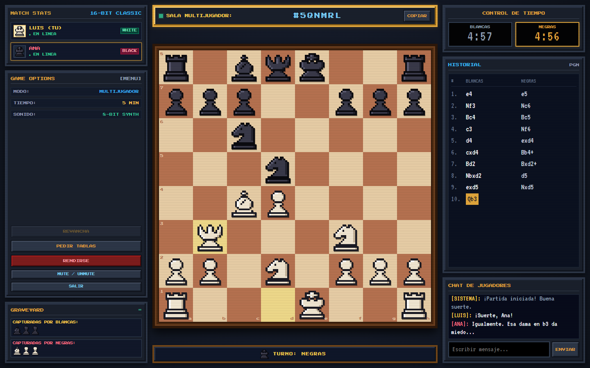

## Objetivo

Un sistema formado por dos aplicaciones, un **frontend** web y un **backend** Java, en el que un jugador crea una sala, comparte su código y otro jugador se une para jugar una partida de ajedrez en tiempo real. El backend valida todas las reglas del ajedrez, coordina las salas y registra cada partida movimiento a movimiento en una base de datos SQLite, de forma que puede consultarse y reconstruirse después.

Las dos aplicaciones siguen una **arquitectura hexagonal**: el dominio y los casos de uso están en el centro, y la interfaz, HTTP, WebSocket y la base de datos son adaptadores intercambiables.

Como **idea propia**, se puede jugar también **contra la IA** con tres niveles de dificultad (ver [Idea propia](#idea-propia-jugar-contra-la-ia)).

## Índice

- [Funcionalidades](#funcionalidades)
- [Capturas](#capturas)
- [Cómo ejecutarlo](#cómo-ejecutarlo)
- [Estructura del repositorio](#estructura-del-repositorio)
- [Arquitectura de sistemas](#arquitectura-de-sistemas)
- [Arquitectura hexagonal](#arquitectura-hexagonal)
- [Modelo de datos](#modelo-de-datos)
- [Cómo se conectan los usuarios](#cómo-se-conectan-los-usuarios)
- [Reglas del ajedrez implementadas](#reglas-del-ajedrez-implementadas)
- [Idea propia: jugar contra la IA](#idea-propia-jugar-contra-la-ia)
- [Contrato de comunicación (API)](#contrato-de-comunicación-api)
- [Persistencia y trazabilidad](#persistencia-y-trazabilidad)
- [Verificación](#verificación)
- [Decisiones de diseño](#decisiones-de-diseño)
- [Límites conocidos](#límites-conocidos)

## Funcionalidades

| Funcionalidad | Estado |
|---|---|
| Reglas de movimiento de todas las piezas | ✅ |
| Jaque y movimientos que dejan el rey en jaque | ✅ |
| En passant | ✅ |
| Enroque (corto y largo) | ✅ |
| Promoción con elección de pieza | ✅ |
| Jaque mate y ahogado | ✅ |
| Tablas por material insuficiente y regla de los 50 movimientos | ✅ |
| Salas para dos jugadores: crear, unirse con código, un color por jugador | ✅ |
| Sincronización en tiempo real entre jugadores (WebSocket) | ✅ |
| Persistencia de partidas, movimientos, salas y chat (SQLite) | ✅ |
| Partida local (dos jugadores en la misma pantalla) | ✅ |
| Nombres de jugador y presencia (conectado / desconectado) | ✅ |
| Reloj por jugador controlado por el servidor (sin reloj, 3, 5, 10 o 15 minutos) | ✅ |
| Rendirse, ofrecer / aceptar / rechazar tablas, revancha con cambio de colores | ✅ |
| Historial en notación SAN y exportación a PGN | ✅ |
| Piezas capturadas y ventaja de material | ✅ |
| Chat entre los dos jugadores | ✅ |
| Interfaz retro 16-bit: piezas pixel-art propias, sonidos 8-bit | ✅ |
| **Idea propia**: jugar contra la IA (fácil, medio y difícil; con blancas o negras) | ✅ |
| Tests automáticos (JUnit 6, 191 tests) | ✅ |

## Capturas

Todas las capturas están en [`docs/`](docs) y se hicieron con el sistema funcionando: backend real, base de datos SQLite y dos navegadores conectados a la misma sala.

**Inicio: crear una sala o unirse con un código.** El jugador escribe su nombre, elige el tiempo y crea la sala; el rival escribe el código y pulsa *Unirse*.

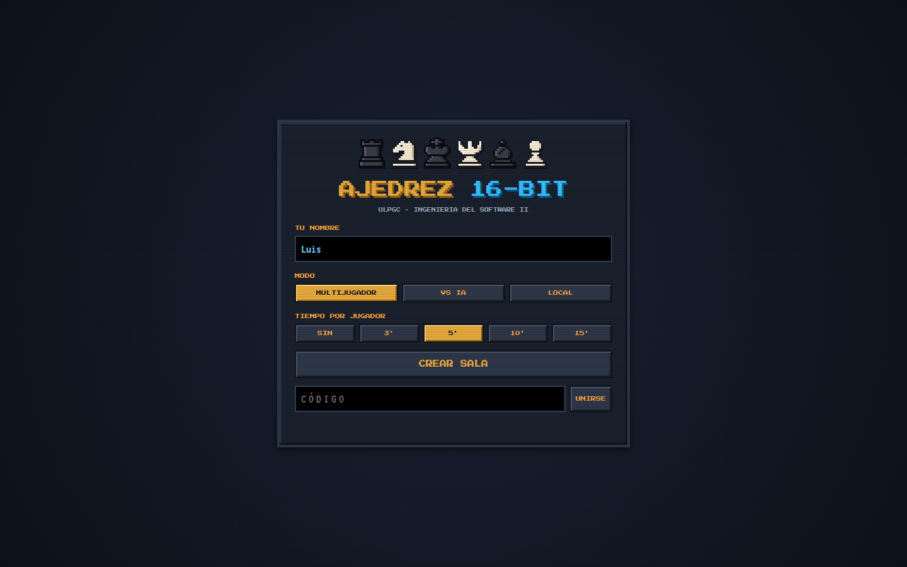

**Sala recién creada, esperando al rival.** El código (`#5QNMRL`) se puede copiar con un botón. Hasta que llega el rival no se puede mover y el reloj no corre.

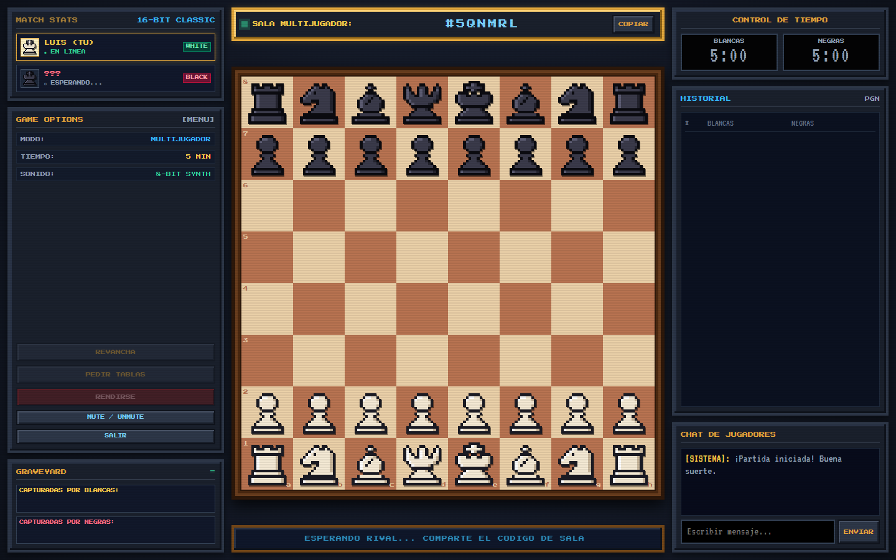

**Partida en curso, vista de las blancas (Luis).** Se ven los dos jugadores conectados, los relojes, el historial en SAN (con jaques `Bb4+` y desambiguación `Nbxd2`), las piezas capturadas y el chat. La última jugada aparece resaltada.


**La misma partida, vista de las negras (Ana), en otro navegador.** El tablero se gira según tu color y todo llega en tiempo real por WebSocket.

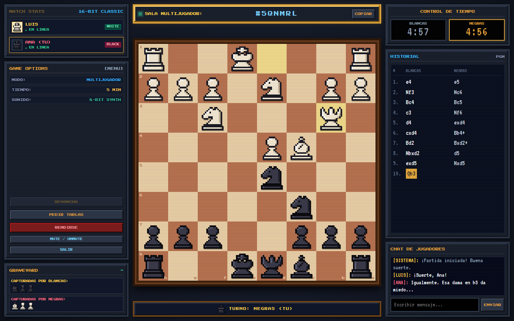

**Una partida terminada: jaque mate del pastor.** El historial termina en `Qxf7#`, el rey mateado se marca en rojo y se ofrece la revancha.

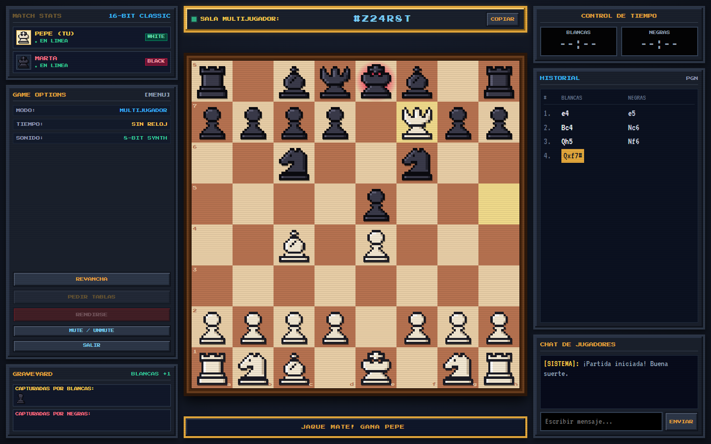

**Histórico registrado: la partida tras reiniciar el backend.** Se paró el servidor, se volvió a arrancar y se recargó la página: la partida se reconstruye desde la base de datos con los mismos movimientos, el mismo chat y el tiempo de cada reloj.

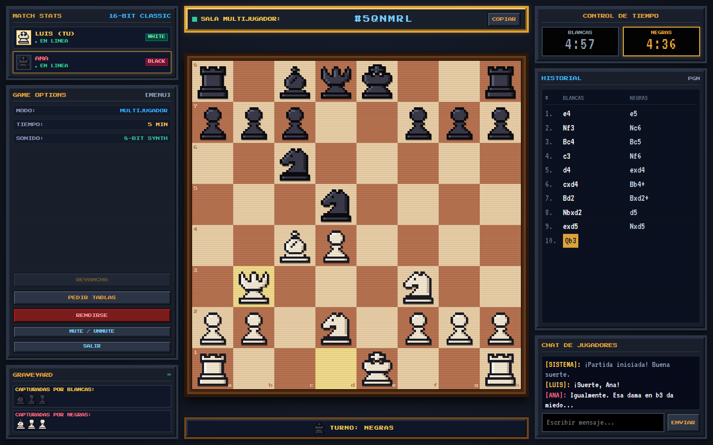

**Idea propia: elegir nivel y color para jugar contra la IA.**

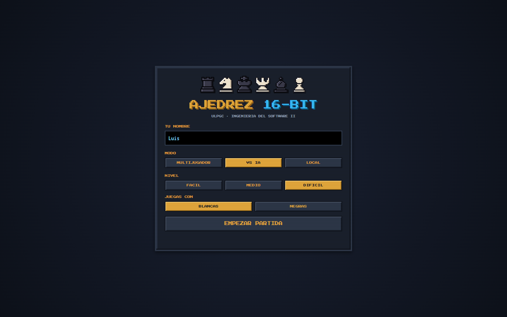

**Partida contra la IA en nivel difícil.** La IA (minimax) aprovecha que el peón de e4 quedó sin defender (`Bxe4`) y después retira el alfil a una casilla segura.

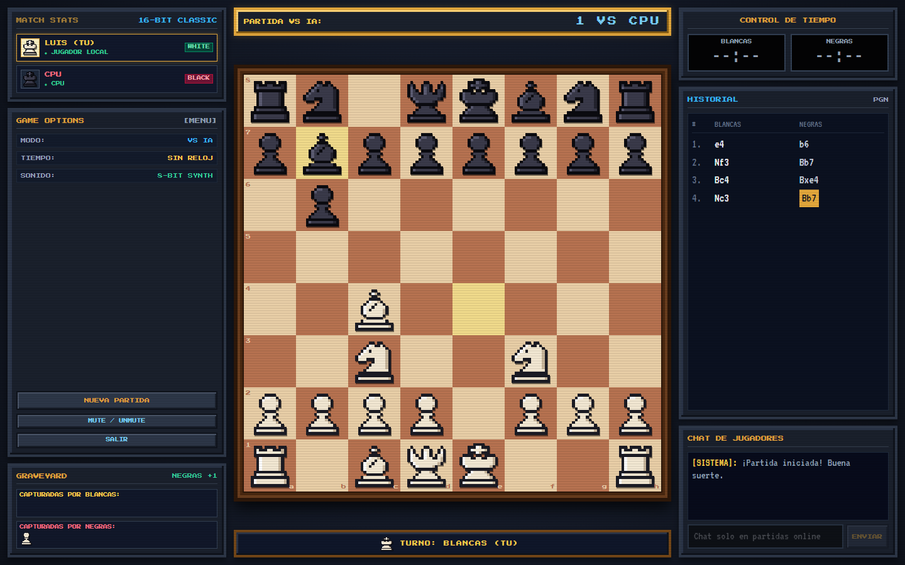

## Cómo ejecutarlo

### Requisitos y dependencias

- **JDK 27**.
- **Maven 3.9** o superior, o IntelliJ IDEA, que trae Maven integrado.
- Un navegador moderno. El frontend no necesita instalar nada: no tiene dependencias ni paso de compilación.

Dependencias del backend (en `backend/pom.xml`, Maven las descarga solas):

| Dependencia | Versión | Para qué |
|---|---|---|
| `io.javalin:javalin` | 7.2.3 | Servidor HTTP, WebSocket y ficheros estáticos |
| `com.fasterxml.jackson.core:jackson-databind` | 2.22.4 | JSON |
| `org.xerial:sqlite-jdbc` | 3.53.4.0 | Base de datos SQLite |
| `org.slf4j:slf4j-simple` | 2.0.20 | Logs de Javalin |
| `org.junit.jupiter:junit-jupiter` | 6.1.3 | Tests (solo en `test`) |

El frontend usa las fuentes *Press Start 2P* y *VT323* de Google Fonts. Sin conexión a Internet funciona igual, pero con la fuente por defecto.

### Arrancar

El backend sirve también el frontend, así que basta con arrancar **un único proceso desde la raíz del repositorio**. Ejecuta `software.ulpgc.chess.infrastructure.Main` desde IntelliJ, o bien:

```
mvn -f backend/pom.xml compile exec:java -Dexec.mainClass=software.ulpgc.chess.infrastructure.Main
```

Abre **http://localhost:7070**.

Para probar una sala tú solo, abre dos pestañas. En una elige *Multijugador*, el tiempo y pulsa *Crear sala*. En la otra escribe el código y pulsa *Unirse*. La sesión se guarda por pestaña (`sessionStorage`), así que cada pestaña es un jugador distinto y recargar no te saca de la sala.

Para jugar desde **otro ordenador de la misma red**, ese ordenador abre `http://<IP de tu equipo>:7070`. Puede que haya que permitir Java en el firewall de Windows la primera vez.

### Configuración

Todo se configura con variables de entorno opcionales. No hay rutas absolutas ni nada fijo de una máquina concreta:

| Variable | Por defecto | Descripción |
|---|---|---|
| `PORT` | `7070` | Puerto del servidor (página, API y WebSocket) |
| `STORAGE` | (SQLite) | `memory` para no guardar nada en disco |
| `DATABASE` | `chess.db` | Ruta del archivo SQLite, relativa al directorio de trabajo. Se crea solo; está en `.gitignore` |
| `FRONTEND` | `frontend` | Carpeta del frontend que sirve Javalin, relativa al directorio de trabajo |

Javalin sirve los ficheros del frontend con `config.staticFiles` (`Location.EXTERNAL`). La página y la API comparten origen, así que no hace falta CORS y el frontend usa `location.origin` como URL de la API. Los módulos ES no funcionan abriendo el HTML con doble clic (`file://`); siempre hay que entrar por `http://localhost:7070`.

### Tests

```
mvn -f backend/pom.xml test
```

O, en IntelliJ, click derecho en `backend/src/test/java` → *Run 'All Tests'*. Ver [Verificación](#verificación).

## Estructura del repositorio

```
chess-software/
├── backend/
│   ├── pom.xml
│   └── src/
│       ├── main/java/software/ulpgc/chess/
│       │   ├── domain/            Reglas del ajedrez y de las salas (Java puro)
│       │   │   └── ai/            Motores de IA (idea propia)
│       │   ├── application/       Casos de uso y puertos
│       │   └── infrastructure/    Adaptadores: http/, websocket/, persistence/ y Main
│       └── test/java/...          Tests JUnit, con la misma estructura de paquetes
├── frontend/
│   ├── index.html
│   ├── css/styles.css
│   └── js/
│       ├── application/           Puertos, casos de uso y PGN
│       ├── infrastructure/        Adaptadores: HTTP/WebSocket, mocks, vistas, sonido, almacenamiento
│       └── main.js                Raíz de composición
├── docs/                          Capturas del README
└── README.md
```

## Arquitectura de sistemas

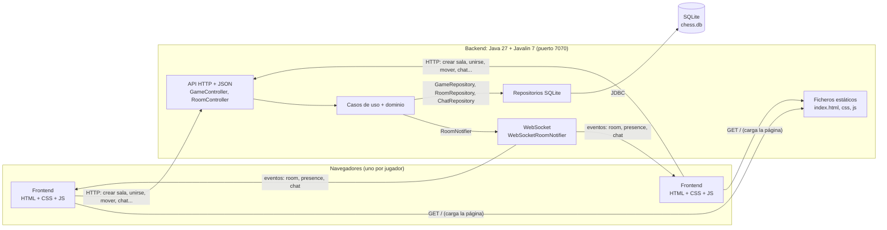

- **Frontend**: una página web sin dependencias. Dibuja el tablero, recoge los clics y muestra el estado que le manda el backend. **No conoce las reglas del ajedrez** ni escribe en la base de datos.
- **Backend**: un único proceso Java. Valida cada movimiento, decide el estado de la partida, lleva los relojes, coordina las salas y guarda todo.
- **Base de datos**: un archivo SQLite al que solo accede el backend, a través de sus repositorios.
- **Contratos** (detallados en [Contrato de comunicación](#contrato-de-comunicación-api)):
  - **HTTP + JSON** para todo lo que el usuario *hace*: crear o unirse a una sala, mover, rendirse, tablas, revancha, chat. Cada petición recibe una respuesta con su código (200, 201, 400, 403, 404, 409, 422).
  - **WebSocket**, solo de bajada, para todo lo que el usuario *recibe* sin pedirlo: la jugada del rival, si se ha conectado o desconectado, y los mensajes del chat.

| Responsabilidad | Frontend | Backend |
|---|---|---|
| Reglas del ajedrez y movimientos legales | Solo pinta las casillas que le dice el backend | ✅ Las valida todas |
| Notación SAN, piezas capturadas, estado de la partida | Solo las muestra | ✅ Las calcula |
| Relojes | Descuenta en pantalla entre actualizaciones | ✅ Lleva el tiempo real |
| Salas, jugadores y turnos | Guarda su token en la pestaña | ✅ Decide quién puede hacer qué |
| Persistencia | ❌ | ✅ |
| Exportar PGN | ✅ A partir del historial SAN | |
| Sonidos, animaciones, preferencias del usuario | ✅ | |

## Arquitectura hexagonal

Las dos aplicaciones siguen el mismo esquema: el núcleo (dominio y casos de uso) no depende de ningún framework ni de la tecnología de comunicación, define **puertos** (interfaces) para lo que necesita del exterior, y cada detalle técnico es un **adaptador** que implementa un puerto. Una única **raíz de composición** (`Main.java` en el backend, `main.js` en el frontend) conoce las implementaciones concretas y las conecta.

### Backend (`software.ulpgc.chess`)

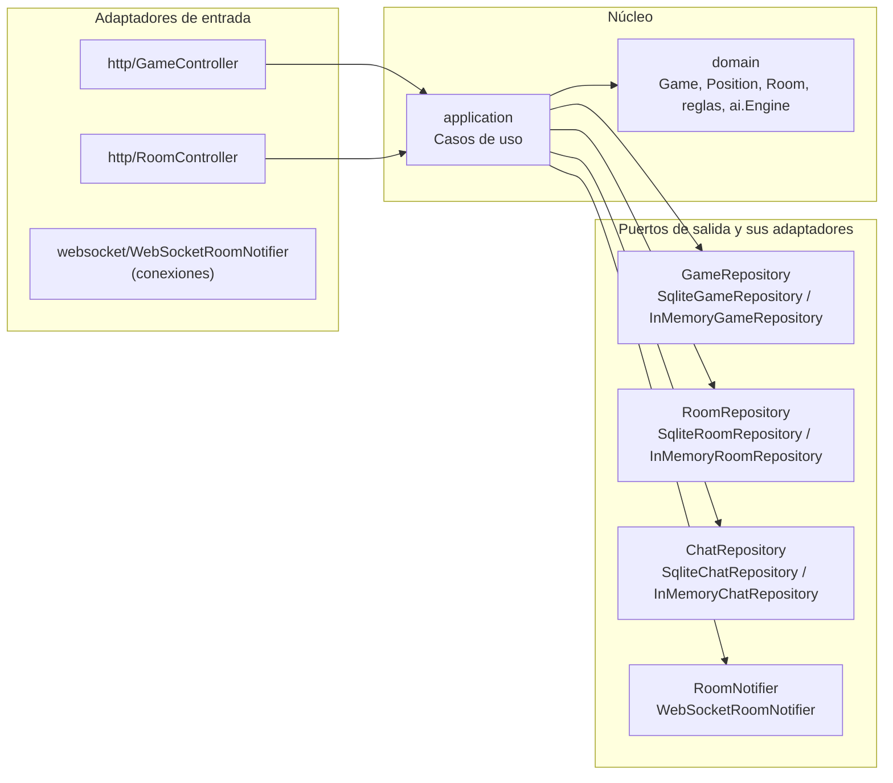

```
domain/           Reglas del ajedrez y de las salas. Java puro, sin dependencias externas.
application/      Casos de uso y los puertos (interfaces) que necesitan.
infrastructure/   Adaptadores: HTTP y WebSocket (Javalin), persistencia (SQLite y memoria) y punto de entrada (Main).
```

- **`domain`**: modelo inmutable.
  - `Board` (piezas), `Position` (tablero + turno + derechos de enroque + casilla de en passant + contador de medios movimientos, el mismo contenido que una cadena FEN).
  - `Game`: identificador + posición + historial de `PlayedMove` (movimiento, su notación SAN y la pieza capturada) + `Ending` (final forzado: rendición, tablas acordadas o tiempo) + `ChessClock`.
  - `ChessClock`: tiempo restante de cada jugador y momento en que empezó el turno actual. Recibe siempre el instante actual como parámetro, así que no depende del reloj del sistema.
  - `SanFormatter`: traduce un movimiento a notación algebraica estándar (`Nf3`, `exd5`, `O-O`, `e8=Q+`, desambiguación `Nbd2`…).
  - Cada regla vive en una clase pequeña:
    - `KnightMovementRule`, `PawnMovementRule`… implementan `MovementRule`, y `MovementRules` despacha según el tipo de pieza.
    - `AttackDetector` sabe qué casillas están atacadas. `CheckDetector` lo usa para el jaque y `CastlingRule` para que el rey no enroque pasando por casillas atacadas.
    - `LegalMoveValidator` combina las reglas de movimiento, el enroque y la comprobación de que el propio rey no queda en jaque.
    - `LegalMoveGenerator` lista los movimientos legales. `GameStatusEvaluator` decide si la partida sigue, es mate, ahogado o tablas.
  - `Room`: código de sala, partida asociada, los dos `Seat` (token secreto + nombre) y las ofertas pendientes de tablas y de revancha. Contiene las reglas de la sala: esperar al rival, solo juegan sus dos jugadores, cada uno en su turno, y la revancha intercambia los colores.
  - `ChatMessage`: mensaje de un jugador (máximo 200 caracteres, nunca vacío).
  - `ai/`: los motores de IA (ver [Idea propia](#idea-propia-jugar-contra-la-ia)).
- **`application`**:
  - Partidas: `CreateGameUseCase`, `GetGameUseCase`, `MovePieceUseCase`, `GetLegalMovesUseCase`.
  - Salas: `CreateRoomUseCase`, `JoinRoomUseCase`, `GetRoomUseCase`, `MoveInRoomUseCase`, `ResignUseCase`, `OfferDrawUseCase` (si el rival ya las había ofrecido, las acepta), `DeclineDrawUseCase`, `RematchUseCase`.
  - Chat: `SendMessageUseCase`, `GetMessagesUseCase`.
  - IA: `PlayAiMoveUseCase`, `GetAiLevelsUseCase`.
  - Puertos de salida: `GameRepository`, `RoomRepository`, `ChatRepository` (persistencia) y `RoomNotifier` (avisar a los jugadores de cambios en la sala y de mensajes nuevos).
  - Los casos de uso que dependen de la hora reciben un `java.time.Clock`, para poder usar un reloj fijo en los tests.
- **`infrastructure`**:
  - `http/`: `GameController` y `RoomController` traducen HTTP ⇄ casos de uso, con DTOs (`GameResponse`, `RoomResponse`, `ClockResponse`, `PlayerResponse`, `SessionResponse`, `ChatMessageResponse`…). También traducen cada excepción del dominio a su código HTTP.
  - `websocket/WebSocketRoomNotifier` implementa `RoomNotifier`: mantiene las conexiones abiertas de cada sala, sabe de qué jugador es cada una (por su token) y envía tres tipos de evento: sala, presencia y chat.
  - `persistence/`: `SqliteGameRepository`, `SqliteRoomRepository` y `SqliteChatRepository` (por defecto), y sus equivalentes en memoria.
  - `Main` monta las piezas y registra los motores de IA. Es el único sitio que conoce todas las implementaciones.

Los casos de uso no saben nada de HTTP, WebSocket, Javalin ni SQLite. **Cambiar la persistencia de SQLite a memoria es una variable de entorno (`STORAGE=memory`)** y no toca ni el dominio ni la aplicación.

### Frontend (`frontend/js`)

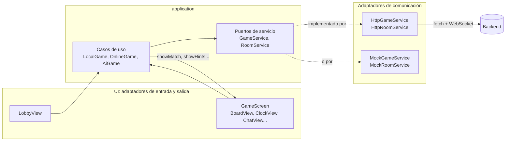

```
application/      Puertos (GameService, RoomService), casos de uso (LocalGame, OnlineGame, AiGame) y generación de PGN.
infrastructure/   Adaptadores: HTTP/WebSocket, mocks, almacenamiento en el navegador, vistas del DOM y sonido.
main.js           Raíz de composición: elige los adaptadores y los conecta.
```

- **Puertos**:
  - `GameService` (`createGame`, `getGame`, `move`, `legalMoves`, `aiMove`, `aiLevels`) para la partida local y contra la IA.
  - `RoomService` (`createRoom`, `joinRoom`, `getRoom`, `move`, `legalMoves`, `resign`, `offerDraw`, `declineDraw`, `rematch`, `messages`, `sendMessage`, `subscribe`) para jugar en sala.
  - La pantalla es otro puerto: los casos de uso solo llaman a `showMatch`, `showHints`, `showMessages`, `addMessage` y `showError`.
- **Casos de uso**: `LocalGame`, `OnlineGame` y `AiGame` orquestan cada modo de juego. No tocan el DOM ni hacen peticiones de red: construyen un objeto `match` con todo lo que hay que mostrar (jugadores, partida, reloj, ofertas…) y se lo pasan a la pantalla.
- **Adaptadores**:
  - Servicios reales: `HttpGameService` y `HttpRoomService`. Este último usa `fetch` y `WebSocket`, y se reconecta solo si la conexión se cae. Las peticiones comparten `http.js`, que convierte las respuestas de error en `HttpError` con su código.
  - `MockGameService` y `MockRoomService`: en memoria y sin reglas, para trabajar en la interfaz sin backend.
  - `GameScreen`: fachada de la pantalla de juego. Reparte el `match` entre vistas pequeñas (`BoardView`, `PlayersView`, `OptionsView`, `GraveyardView`, `RoomBarView`, `TurnBannerView`, `ClockView`, `HistoryView`, `ChatView`) y decide qué sonido suena (`SoundEffects`).
  - `LobbyView` (pantalla de inicio) y `PromotionDialog`.
  - `PixelPieces`: las piezas son dibujos de 16×16 píxeles escritos como texto, que se convierten en SVG.
  - `BrowserSessionStore` (sesión del jugador, por pestaña) y `BrowserPreferences` (nombre, tiempo, nivel de IA y sonido, recordados entre visitas).
- **Para pasar a los mocks basta con poner `USE_MOCK = true` en `main.js`**. Ni los casos de uso ni la UI cambian.
- Las reglas del ajedrez **no se duplican en el frontend**. Lo que hace el frontend (seleccionar solo tus piezas en tu turno, descontar el reloj en pantalla) es comodidad visual: el backend vuelve a validarlo todo.

## Modelo de datos

| Concepto | Clase del dominio | Qué contiene |
|---|---|---|
| **Usuario** | `Seat` | Un token secreto (UUID) y un nombre de hasta 16 caracteres. No hay cuentas: un usuario es un asiento en una sala (ver [Decisiones de diseño](#decisiones-de-diseño)) |
| **Sala** | `Room` | Código de 6 caracteres, partida actual, asiento de blancas y de negras, y ofertas pendientes de tablas y de revancha |
| **Partida** | `Game` | Identificador, `Position` actual, historial de movimientos, final forzado (`Ending`) y reloj (`ChessClock`) |
| **Movimiento** | `Move` / `PlayedMove` | Casilla de origen, de destino y pieza de promoción. `PlayedMove` añade su notación SAN y la pieza capturada |
| **Estado de la partida** | `GameStatus` | `InProgress`, `Checkmate`, `Stalemate`, `InsufficientMaterial`, `FiftyMoveRule`, `Resignation`, `DrawByAgreement` o `Timeout` |
| **Resultado** | `Game.winner()` | `White`, `Black` o ninguno (tablas o en curso) |
| **Mensaje** | `ChatMessage` | Sala, autor (color y nombre), texto y fecha |

En la base de datos se guarda así (ver [Persistencia y trazabilidad](#persistencia-y-trazabilidad)):

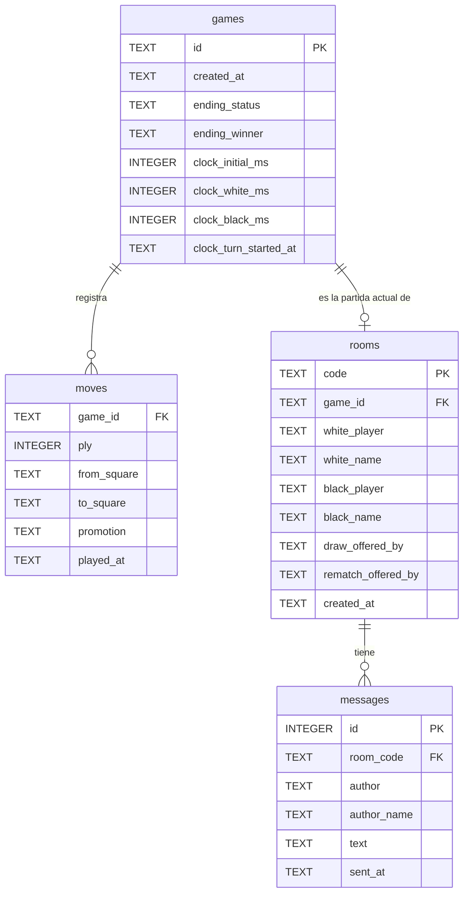

## Cómo se conectan los usuarios

El mecanismo es una **sala privada con código compartido**:

1. El primer jugador crea una sala (`POST /rooms`). El backend genera un **código de 6 caracteres** (por ejemplo `5QNMRL`) con un alfabeto sin caracteres que se confunden (sin `I`, `O`, `0` ni `1`), comprueba que no exista ya y le asigna las **blancas**.
2. El jugador comparte el código (hay un botón para copiarlo).
3. El segundo jugador lo escribe y se une (`POST /rooms/{code}/players`). Recibe las **negras** y empieza a correr el reloj. Si la sala ya tiene dos jugadores, recibe un `409`.
4. Cada jugador recibe un **token secreto** solo al crear o unirse a la sala. El frontend lo guarda en `sessionStorage` y lo envía en la cabecera `X-Player-Token` en cada acción. Sin el token de un jugador nadie puede mover por él.
5. Los dos abren un **WebSocket** con la sala (`/rooms/{code}/events`). Por ahí les llegan las jugadas del rival, los mensajes del chat y si el rival está conectado.

**Desconexiones**: si un jugador cierra la pestaña o pierde la conexión, el rival lo ve como *Desconectado*. La partida no se pierde: el reloj sigue corriendo en el servidor, el frontend se reconecta solo y, al recargar la página, la sesión de la pestaña vuelve a entrar en la misma sala.

Quien conoce el código pero no tiene token puede consultar la sala (`GET /rooms/{code}`) como espectador (`"you": null`), pero no puede mover ni escribir (`403`).

## Reglas del ajedrez implementadas

El backend valida **todas las reglas del reglamento** salvo las tablas por triple repetición:

- Movimiento de cada pieza, incluido que las piezas no atraviesen a otras (salvo el caballo).
- No se puede mover a una casilla ocupada por una pieza propia.
- Ningún movimiento puede dejar al propio rey en jaque (piezas clavadas, el rey no puede ir a casillas atacadas ni capturar piezas defendidas, hay que responder al jaque).
- Enroque corto y largo: el rey y la torre no se han movido, las casillas intermedias están vacías, y el rey no está en jaque ni pasa ni llega a una casilla atacada.
- Peón: avance de una casilla, de dos desde su fila inicial, captura en diagonal, **en passant** (solo justo después del avance doble) y **promoción** a dama, torre, alfil o caballo.
- Final de partida: jaque mate, ahogado, material insuficiente (rey contra rey, rey y pieza menor contra rey, y alfiles en casillas del mismo color) y regla de los 50 movimientos.
- Finales que no dependen del tablero: rendición, tablas de mutuo acuerdo y tiempo agotado.

Una vez terminada la partida, cualquier movimiento se rechaza con `409`.

## Idea propia: jugar contra la IA

### Qué es

Un tercer modo de juego, **VS IA**, además de *Multijugador* y *Local*. En la pantalla de inicio se elige el nivel y el color, y se juega contra la CPU:

| Nivel | Motor | Cómo juega |
|---|---|---|
| Fácil | `RandomEngine` | Un movimiento legal al azar |
| Medio | `GreedyEngine` | Captura la pieza de más valor que pueda; si no hay ninguna captura, juega al azar. No mira qué pasa después, así que cae en trampas |
| Difícil | `MinimaxEngine` | Minimax con poda alfa-beta a 3 medios movimientos. Ve mates en una y dos jugadas, no regala piezas y aprovecha las que se dejan sin defender |
| Experto | `ExpertEngine` | Negamax con poda alfa-beta, profundización iterativa (hasta 3 s por jugada), ordenación de jugadas y búsqueda de quiescencia. Evalúa material y posición: centraliza, desarrolla, enroca y, en el final, arrincona al rey rival |

Mientras la IA piensa, el panel del jugador muestra *Pensando...*. Si eliges negras, la IA hace la primera jugada.

### Cómo está hecho

- **Dominio** (`domain/ai/`): la interfaz `Engine` tiene un único método, `Move chooseMove(Position)`. Cada nivel es una implementación (**patrón Strategy**). `PositionEvaluator` puntúa una posición por material (`PieceValues`, en centésimas de peón: peón 100, caballo y alfil 300, torre 500, dama 900). En minimax, un mate vale más cuanto antes llega y las tablas valen 0.
- **Nivel experto** (`domain/ai/`): `ExpertEngine` busca primero a profundidad 1, luego 2, 3... hasta agotar el tiempo, y se queda con la última búsqueda completa (*iterative deepening*); la mejor jugada de una vuelta se prueba la primera en la siguiente. `MoveOrdering` ordena las jugadas para que alfa-beta pode más (primero comer la pieza más valiosa con la menos valiosa). Al llegar a la profundidad límite no evalúa sin más: sigue mirando solo capturas hasta que la posición queda tranquila (*quiescencia*, con `LegalMoveGenerator.allLegalCaptures`), así no cae en el efecto horizonte de comer un peón con la dama sin ver que se la comen después. `PositionalEvaluator` suma al material las tablas pieza-casilla de `PieceSquareTables` (otra tabla para el rey en el final) y, en finales ganados, premia acercar el rey propio y llevar el rival al borde.
- **Aplicación**: `PlayAiMoveUseCase` carga la partida, pide el movimiento al motor del nivel elegido, lo juega con las mismas reglas que cualquier otro movimiento y lo guarda. `GetAiLevelsUseCase` dice qué niveles hay.
- **Infraestructura**: `Main` registra los motores en un mapa ordenado (`random`, `greedy`, `minimax`, `expert`). Hay dos rutas nuevas, `POST /games/{id}/ai-move?level=...` y `GET /ai/levels`.
- **Frontend**: un caso de uso nuevo, `AiGame`, al lado de `LocalGame` y `OnlineGame`. El lobby construye los botones de nivel a partir de `GET /ai/levels`.

### Por qué encaja con el trabajo

- **Reutiliza el núcleo sin tocarlo**: los motores usan `LegalMoveGenerator` y `GameStatusEvaluator`, las mismas clases que validan las partidas entre personas. La IA no puede hacer trampas porque su movimiento pasa por `Game.play`, igual que el de un jugador. Esto demuestra que el dominio es independiente de quién mueve.
- **Demuestra la arquitectura hexagonal**: añadir un modo de juego entero no cambió ni un caso de uso existente ni el contrato de las salas. Añadir un nivel nuevo es escribir una clase que implemente `Engine` y registrarla en `Main`: el frontend la muestra sola. Del mismo modo, se podría conectar un motor externo (por ejemplo Stockfish) como otro adaptador.
- **Mejora la experiencia**: el sistema sirve también cuando no hay un segundo jugador disponible, para practicar o para probar la aplicación uno solo.
- **Las partidas contra la IA también se registran** en la base de datos, igual que las demás.

### Rendimiento

Minimax no puede recorrer el árbol completo del ajedrez, como sí se puede en el 3 en raya: hay unos 35 movimientos posibles por posición, así que 6 medios movimientos ya son casi 2.000 millones de posiciones. Por eso busca a profundidad fija y evalúa la posición a la que llega. Medido en este proyecto, con poda alfa-beta: unos **100 ms por jugada a profundidad 3** y unos 600 ms a profundidad 4 en mitad de partida. Se eligió 3 para que la respuesta sea inmediata.

El nivel experto, en cambio, tiene un límite de tiempo: 3 segundos por jugada (si una vuelta termina después de la mitad del tiempo, ya no empieza la siguiente). Así llega a profundidad 4 o 5 más la quiescencia. Para que llegara tan hondo se midió con un perfilador (JFR) dónde se iba el tiempo: la mitad se gastaba buscando casillas en el mapa del tablero, porque el `hashCode` generado del record `Square` es lento. Con un `hashCode` propio (`file * 8 + rank`, sin colisiones) la búsqueda va el doble de rápido. En dos partidas de prueba, experto contra difícil, ganó experto las dos (una con cada color).

## Contrato de comunicación (API)

Todas las peticiones y respuestas son JSON. Los errores siempre tienen la forma `{ "error": "mensaje" }`.

### Partidas (modo local y contra la IA)

| Método | Ruta | Descripción | Respuestas |
|---|---|---|---|
| `POST` | `/games` | Crea una partida | 201 |
| `GET` | `/games/{id}` | Estado de una partida, con todo su historial | 200, 404 |
| `GET` | `/games/{id}/moves?from=e2` | Casillas a las que puede moverse la pieza de `from` | 200, 400, 404 |
| `POST` | `/games/{id}/moves` | Realiza un movimiento | 200, 400, 404, 409, 422 |
| `POST` | `/games/{id}/ai-move?level=random` | La IA del nivel indicado juega el movimiento del bando que mueve | 200, 400, 404, 409 |
| `GET` | `/ai/levels` | Niveles de IA disponibles, en orden | 200 |

### Salas

Las rutas marcadas con 🔑 requieren la cabecera `X-Player-Token`.

| Método | Ruta | Descripción | Respuestas |
|---|---|---|---|
| `POST` | `/rooms` | Crea una sala. El creador juega con blancas. Cuerpo opcional: `{ "name": "Luis", "minutes": 5 }` (0 = sin reloj, máximo 60) | 201, 400 |
| `POST` | `/rooms/{code}/players` | Se une a la sala como negras. Cuerpo opcional: `{ "name": "Ana" }`. Arranca el reloj | 201, 404, 409 |
| `GET` | `/rooms/{code}` | Estado de la sala. Con el token, `you` indica tu color | 200, 404 |
| `POST` | `/rooms/{code}/moves` 🔑 | Mueve | 200, 400, 403, 404, 409, 422 |
| `POST` | `/rooms/{code}/resign` 🔑 | Se rinde | 200, 403, 404, 409 |
| `POST` | `/rooms/{code}/draw-offer` 🔑 | Ofrece tablas, o las acepta si el rival ya las había ofrecido | 200, 403, 404, 409 |
| `DELETE` | `/rooms/{code}/draw-offer` 🔑 | Rechaza (o retira) la oferta de tablas | 200, 403, 404 |
| `POST` | `/rooms/{code}/rematch` 🔑 | Pide revancha; cuando la piden los dos empieza una partida nueva con los colores cambiados | 200, 403, 404, 409 |
| `GET` | `/rooms/{code}/messages` | Mensajes del chat | 200, 404 |
| `POST` | `/rooms/{code}/messages` 🔑 | Envía un mensaje: `{ "text": "hola" }` | 201, 400, 403, 404 |
| `WS` | `/rooms/{code}/events?token=…` | Eventos de la sala (ver abajo) | — |

Crear o unirse a una sala devuelve el token del jugador. **Es la única vez que se envía**: ninguna otra respuesta incluye tokens.

```json
{ "color": "White", "playerToken": "…", "room": { "…": "…" } }
```

Estado de una sala:

```json
{
  "code": "5QNMRL",
  "you": "White",
  "white": { "name": "Luis", "joined": true },
  "black": { "name": "Ana", "joined": true },
  "drawOfferedBy": null,
  "rematchOfferedBy": null,
  "clock": { "initialMillis": 300000, "whiteMillis": 296194, "blackMillis": 279597, "running": "Black" },
  "game": { "…": "…" }
}
```

- `you` es el color de quien hace la petición (según su token), o `null` para un espectador. Hace falta porque la revancha intercambia los colores.
- `clock` es `null` en las salas sin reloj. Los tiempos están calculados en el momento de responder y `running` dice qué reloj corre (`null` si está parado). Si a un jugador se le acaba el tiempo, la siguiente petición a la sala cierra la partida con `Timeout`.

Eventos del WebSocket. El token va en la URL porque un WebSocket del navegador no puede llevar cabeceras propias; sirve para saber qué jugador está conectado.

```json
{ "type": "room", "room": { "…": "…" } }
{ "type": "presence", "white": true, "black": false }
{ "type": "chat", "message": { "author": "White", "authorName": "Luis", "text": "¡Suerte!", "sentAt": "2026-10-21T16:00:00Z" } }
```

### Formatos comunes

Cuerpo de un movimiento. `promotion` es opcional (`q`, `r`, `b` o `n`); si se omite, la promoción es a dama:

```json
{ "from": "e7", "to": "e8", "promotion": "n" }
```

Estado de una partida:

```json
{
  "id": "…",
  "sideToMove": "White",
  "pieces": { "e1": "K", "e8": "k", "…": "…" },
  "status": "InProgress",
  "winner": null,
  "inCheck": false,
  "moves": ["e2e4", "d7d5", "e4d5"],
  "san": ["e4", "d5", "exd5"],
  "captured": { "White": ["p"], "Black": [] }
}
```

- `pieces` usa notación FEN: mayúsculas para blancas y minúsculas para negras.
- `status` puede ser `InProgress`, `Checkmate`, `Stalemate`, `InsufficientMaterial`, `FiftyMoveRule`, `Resignation`, `DrawByAgreement` o `Timeout`.
- `winner` tiene valor (`White` o `Black`) en jaque mate, rendición y tiempo agotado.
- `inCheck` indica si el bando que mueve está en jaque.
- `moves` es el historial en notación UCI (origen + destino + pieza de promoción, por ejemplo `e7e8q`) y `san` el mismo historial en notación algebraica estándar.
- `captured` son las piezas que ha capturado cada bando.

Códigos de error:

| Código | Significado |
|---|---|
| 400 | Datos mal formados o incompletos (casilla o pieza de promoción inválidas, mensaje vacío o demasiado largo, minutos fuera de rango, nivel de IA desconocido) |
| 403 | No es tu turno, o el token no corresponde a ningún jugador de la sala |
| 404 | La partida o la sala no existen |
| 409 | La partida ha terminado (o todavía no, en el caso de la revancha), la sala está llena o todavía falta el rival |
| 422 | Movimiento ilegal |

## Persistencia y trazabilidad

SQLite, en un único archivo (`chess.db`), con cuatro tablas (ver el diagrama en [Modelo de datos](#modelo-de-datos)):

| Tabla | Contenido |
|---|---|
| `games` | Una fila por partida (de sala, local o contra la IA): fecha de creación, final forzado (rendición, tablas acordadas o tiempo) y estado del reloj |
| `moves` | Una fila por movimiento: partida, número de medio movimiento, origen, destino, promoción y fecha |
| `rooms` | Una fila por sala: código, partida actual, token y nombre de cada jugador, y ofertas pendientes |
| `messages` | Una fila por mensaje del chat, con su autor y su fecha |

**El tablero no se guarda: se guarda la lista de movimientos** y la partida se reconstruye repitiéndolos desde la posición inicial (`Game.restore`). Esto tiene varias ventajas:
- el historial completo, con fecha de cada jugada, queda registrado (trazabilidad),
- no hace falta inventar un formato para guardar el tablero,
- y cada movimiento se vuelve a validar al cargar.

Al arrancar se crean las tablas que falten y se añaden las columnas nuevas a una base de datos de una versión anterior (`ALTER TABLE … ADD COLUMN`), así que un `chess.db` antiguo sigue funcionando.

Una partida registrada se consulta con `GET /games/{id}` (estado e historial completo), `GET /rooms/{code}` (la partida actual de una sala, con los jugadores y el reloj) y `GET /rooms/{code}/messages` (el chat). Desde el frontend, el panel de historial muestra la partida en SAN y el botón **PGN** la descarga en el formato estándar, que se puede abrir en cualquier programa de ajedrez.

## Verificación

### Tests automáticos

**191 tests JUnit** del backend, todos en verde:

```
mvn -f backend/pom.xml test
...
Tests run: 191, Failures: 0, Errors: 0, Skipped: 0
BUILD SUCCESS
```

Están en `backend/src/test/java`, en el mismo paquete que la clase que prueban:

| Capa | Qué se prueba |
|---|---|
| `domain` | Movimiento de cada pieza, jaque y clavadas, enroque (incluida la casilla atacada que la torre sí puede cruzar), en passant, promoción, mate, ahogado, material insuficiente, regla de los 50 movimientos, SAN, reloj, reglas de la sala, chat |
| `domain.ai` | Random siempre juega un movimiento legal; greedy captura la pieza de más valor; minimax encuentra el mate en una (con blancas y con negras) y no captura un peón defendido con la dama; experto encuentra el mate en una y en dos, y gracias a la quiescencia no se come el peón defendido ni siquiera a profundidad 1; el evaluador posicional es simétrico y prefiere un caballo centrado |
| `application` | Casos de uso con repositorios en memoria: crear y unirse a salas, turnos, tiempo agotado, tablas, rendición, revancha, chat, partidas locales e IA |
| `infrastructure.persistence` | Los repositorios SQLite guardan y recuperan partidas (con promociones, final y reloj), salas y mensajes, sobre una base de datos temporal, también tras cerrarla y volver a abrirla |

Ayudantes de test:
- `Positions` monta posiciones a partir de una lista de piezas (`"Ke1"`, `"ra8"`: mayúsculas blancas, minúsculas negras).
- `Games` juega una partida a partir de movimientos en notación UCI (`"e2e4"`, `"a7b8n"`).
- `MutableClock` es un reloj que se adelanta a mano, para probar el tiempo sin esperar.
- `RecordingNotifier` apunta los avisos que se enviarían a los jugadores.
- `RoomFixture` monta todos los casos de uso de salas con repositorios en memoria.

Para comprobar que los tests detectan errores de verdad, se rompieron a propósito dos reglas (cruzar una casilla atacada al enrocar y la regla de los 50 movimientos) y los tests correspondientes fallaron.

El frontend no tiene tests automáticos: no usa herramientas de compilación ni dependencias, y toda la lógica del juego está en el backend. Se verificó manualmente (abajo).

### Comprobaciones manuales

Hechas sobre el sistema completo, con el backend real, SQLite y dos navegadores. Las capturas de cada paso están en [Capturas](#capturas).

| Comprobación | Resultado |
|---|---|
| Ejecutar desde una copia limpia | `git clone` del repositorio en una carpeta vacía → `mvn test` (191 tests en verde) → arrancar `Main` → la página carga en `http://localhost:7070`, `GET /ai/levels` devuelve `["random","greedy","minimax","expert"]` y `POST /rooms` devuelve `201` |
| Crear una sala y unir a dos usuarios | Luis crea la sala `5QNMRL`, Ana se une con el código desde otro navegador (capturas 2, 3 y 4) |
| Registrar varios movimientos | 19 medios movimientos de una apertura italiana, con capturas, jaques y desambiguación (`Nbxd2`). Cada jugador ve los del otro en tiempo real |
| Consultar el histórico | `GET /games/{id}` devuelve los 19 movimientos en UCI y en SAN, y las piezas capturadas |
| Reiniciar el backend | Se paró y se volvió a arrancar el servidor: `GET /rooms/5QNMRL` devuelve **exactamente la misma partida**, el chat sigue ahí y el reloj conserva el tiempo de cada jugador. Al recargar, el navegador vuelve a la sala (captura 6). La partida terminada en mate sigue como `Checkmate`, ganan blancas |
| Partida contra la IA | En nivel difícil, la IA responde al momento y castiga un peón sin defender (captura 8) |
| Sustituir un adaptador por un doble | Frontend: `USE_MOCK = true` en `main.js` cambia `HttpGameService`/`HttpRoomService` por los mocks sin tocar casos de uso ni UI. Backend: `STORAGE=memory` cambia SQLite por los repositorios en memoria, y los tests de `application` usan esos repositorios más dos dobles (`RecordingNotifier` en lugar del WebSocket y `MutableClock` en lugar del reloj del sistema) sin cambiar ningún caso de uso |

Peticiones inválidas, con la respuesta real del backend (la sala `5QNMRL`, con el turno de las negras):

| Petición | Respuesta |
|---|---|
| Ana intenta mover el caballo de c6 a c4 | `422 {"error":"Illegal move: c6 -> c4"}` |
| Ana intenta mover el rey blanco (e1 → e3) | `422 {"error":"Illegal move: e1 -> e3"}` |
| Ana envía una casilla que no existe (`z9`) | `400 {"error":"Invalid square: z9"}` |
| Mover con un token que no es de la sala | `403 {"error":"You are not a player of room 5QNMRL"}` |
| Consultar una sala que no existe | `404 {"error":"Room not found: NOPE00"}` |

En la interfaz, estos errores aparecen como un aviso en la franja de turno (por ejemplo *MOVIMIENTO ILEGAL*) y el tablero vuelve a la posición válida.

## Decisiones de diseño

- **Dominio inmutable**: mover devuelve una `Position` nueva en lugar de modificar la actual. Eso permite simular un movimiento para comprobar si deja el rey en jaque sin tener que deshacerlo, y a la IA explorar miles de posiciones sin copiar nada a mano.
- **El enroque no es una `MovementRule`**: `AttackDetector` reutiliza las reglas de movimiento para saber qué casillas están atacadas. Si el enroque fuera una regla más, comprobar ataques podría acabar comprobando enroques, que a su vez comprueban ataques. Además, un enroque nunca ataca. Por eso solo lo consulta `LegalMoveValidator`.
- **El estado de la partida se calcula**: `Game.status()` lo deduce de la posición (mate, ahogado, tablas…). Solo se guardan los finales que no se pueden deducir del tablero: rendición, tablas acordadas y tiempo agotado.
- **El reloj lo lleva el servidor**: se guarda cuánto le queda a cada jugador y cuándo empezó el turno, y el tiempo restante se calcula al momento. El navegador solo lo descuenta en pantalla y, cuando llega a cero, vuelve a pedir la sala para que el servidor lo compruebe. Así nadie puede hacer trampas con el reloj de su ordenador.
- **Jugadores identificados por token, sin cuentas**: al crear o unirse a una sala, el servidor genera un UUID aleatorio que solo conoce ese jugador. Para jugar una partida basta con un nombre, y nadie puede mover por otro.
- **WebSocket solo de bajada**: los movimientos, las ofertas y los mensajes se envían por HTTP, que ya valida, responde errores con su código y es fácil de probar. El WebSocket solo avisa de los cambios. El cliente, al conectarse o reconectarse, pide además el estado actual, por si se perdió algún aviso.
- **El backend sirve el frontend**: un único proceso y un único puerto. La página y la API comparten origen, así que no hace falta CORS ni configurar la URL del backend en el frontend.
- **Casos de uso de sala `synchronized`**: dos peticiones simultáneas (por ejemplo, dos personas uniéndose a la vez) se procesan una detrás de otra.
- **Regla de los 50 movimientos automática**: en el reglamento FIDE es una tabla que se reclama. Aquí se aplica automáticamente para simplificar.
- **Reloj solo en partidas online**: la partida local y la partida contra la IA no tienen reloj.
- **IA con profundidad fija**: ver [Rendimiento](#rendimiento).

## Límites conocidos

- **Reglas**: no se detectan las tablas por triple repetición. La regla de los 50 movimientos se aplica sola, sin que nadie la reclame.
- **Usuarios**: no hay cuentas ni contraseñas. Un jugador es un token guardado en la pestaña del navegador; si borra los datos del navegador o abre la sala en otra pestaña, no puede recuperar su asiento.
- **Historial de una sala**: tras una revancha, la sala apunta a la partida nueva. La anterior sigue guardada (tablas `games` y `moves`) y se puede consultar por su id con `GET /games/{id}`, pero la sala no guarda la lista de sus partidas anteriores. Tampoco hay una lista pública de salas: para entrar hace falta el código.
- **Concurrencia**: los casos de uso de sala están sincronizados, lo que es suficiente para un único servidor. Con varios servidores haría falta coordinarlos (por ejemplo, con la base de datos), y SQLite no está pensada para eso.
- **Comunicación**: los avisos en tiempo real dependen de que el WebSocket esté abierto. Si se cae, el cliente se reconecta solo y pide el estado actual, así que no se pierde nada, pero durante el corte el jugador no ve las jugadas del rival. No hay HTTPS: está pensado para ejecutarse en local o en una red de confianza.
- **IA**: busca a profundidad fija (3 medios movimientos) y solo evalúa el material, así que no entiende estrategia a largo plazo (estructura de peones, seguridad del rey...).
- **Frontend**: sin tests automáticos; verificado manualmente.
