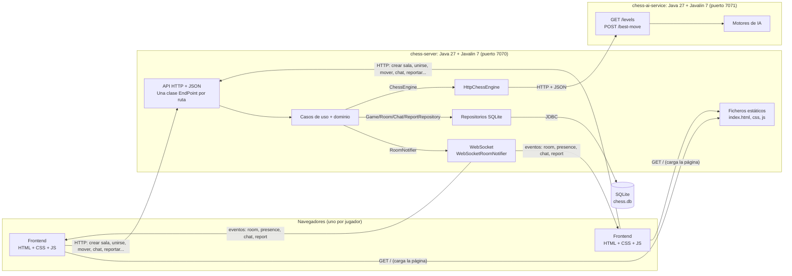
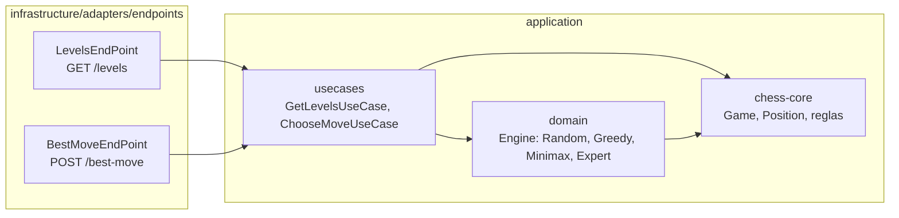
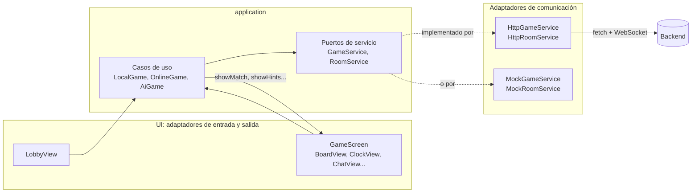
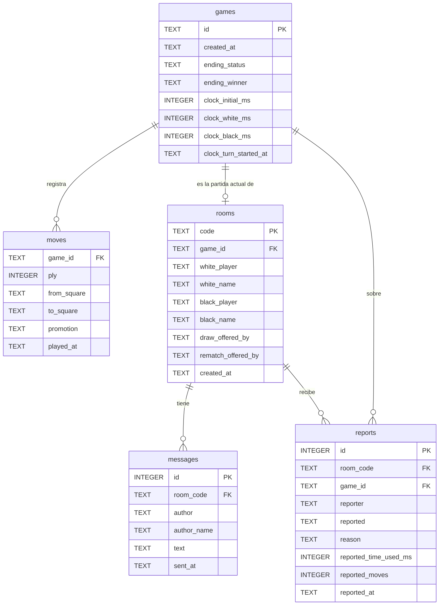

# chess-software

Sistema de salas para jugar al ajedrez. Proyecto individual de **Ingeniería del Software II** (Escuela de Ingeniería Informática, ULPGC).


## Objetivo

Un sistema en el que un jugador crea una sala, comparte su código y otro jugador se une para jugar una partida de ajedrez en tiempo real. Está formado por varios **servicios** dentro de un mismo repositorio:

- **`frontend`**: la aplicación web (HTML, CSS y JavaScript).
- **`chess-server`**: el servicio principal (Java). Valida todas las reglas, coordina las salas y registra cada partida movimiento a movimiento en una base de datos SQLite, de forma que puede consultarse y reconstruirse después.
- **`chess-ai-service`**: un servicio web propio que decide la jugada de la IA. `chess-server` lo **consume** por HTTP.
- **`chess-core`**: una librería con las reglas del ajedrez, sin ninguna dependencia externa, que usan los dos servicios Java.

Todas siguen una **arquitectura hexagonal**: el dominio y los casos de uso están en el centro, y la interfaz, HTTP, WebSocket, la base de datos y el servicio de IA son adaptadores intercambiables.

Como **idea propia**, se puede jugar también **contra la IA** con cuatro niveles de dificultad (ver [Idea propia](#idea-propia-jugar-contra-la-ia)).

## Índice

- [Funcionalidades](#funcionalidades)
- [Capturas](#capturas)
- [Cómo ejecutarlo](#cómo-ejecutarlo)
- [Estructura del repositorio](#estructura-del-repositorio)
- [Arquitectura de sistemas](#arquitectura-de-sistemas)
- [Arquitectura hexagonal](#arquitectura-hexagonal)
- [Principios de diseño aplicados](#principios-de-diseño-aplicados)
- [Modelo de datos](#modelo-de-datos)
- [Cómo se conectan los usuarios](#cómo-se-conectan-los-usuarios)
- [Juego limpio: abandono y reportes](#juego-limpio-abandono-y-reportes)
- [Reglas del ajedrez implementadas](#reglas-del-ajedrez-implementadas)
- [Idea propia: jugar contra la IA](#idea-propia-jugar-contra-la-ia)
- [Contrato de comunicación (API)](#contrato-de-comunicación-api)
- [Persistencia y trazabilidad](#persistencia-y-trazabilidad)
- [Verificación](#verificación)
- [Decisiones de diseño](#decisiones-de-diseño)
- [Límites conocidos](#límites-conocidos)

## Funcionalidades

| Funcionalidad | Estado |
|---|---|
| Reglas de movimiento de todas las piezas | ✅ |
| Jaque y movimientos que dejan el rey en jaque | ✅ |
| En passant | ✅ |
| Enroque (corto y largo) | ✅ |
| Promoción con elección de pieza | ✅ |
| Jaque mate y ahogado | ✅ |
| Tablas por material insuficiente y regla de los 50 movimientos | ✅ |
| Salas para dos jugadores: crear, unirse con código, un color por jugador | ✅ |
| Sincronización en tiempo real entre jugadores (WebSocket) | ✅ |
| Persistencia de partidas, movimientos, salas y chat (SQLite) | ✅ |
| Partida local (dos jugadores en la misma pantalla) | ✅ |
| Nombres de jugador y presencia (conectado / desconectado) | ✅ |
| Reloj por jugador controlado por el servidor (sin reloj, 3, 5, 10 o 15 minutos) | ✅ |
| Rendirse, ofrecer / aceptar / rechazar tablas, revancha con cambio de colores | ✅ |
| Victoria por abandono si el rival se desconecta y no vuelve | ✅ |
| Reportar al rival por mala deportividad (por ejemplo, dejar correr su reloj) | ✅ |
| Historial en notación SAN y exportación a PGN | ✅ |
| Piezas capturadas y ventaja de material | ✅ |
| Chat entre los dos jugadores | ✅ |
| Interfaz retro 16-bit: piezas pixel-art propias, sonidos 8-bit | ✅ |
| **Idea propia**: jugar contra la IA (fácil, medio, difícil y experto; con blancas o negras) | ✅ |
| IA servida como un web service propio (`chess-ai-service`) | ✅ |
| Tests automáticos (JUnit 6, 208 tests) | ✅ |

## Capturas

Todas las capturas están en [`docs/`](docs) y se hicieron con el sistema funcionando: backend real, base de datos SQLite y dos navegadores conectados a la misma sala.

**Inicio: crear una sala o unirse con un código.** El jugador escribe su nombre, elige el tiempo y crea la sala; el rival escribe el código y pulsa *Unirse*.


**Sala recién creada, esperando al rival.** El código (`#5QNMRL`) se puede copiar con un botón. Hasta que llega el rival no se puede mover y el reloj no corre.


**Partida en curso, vista de las blancas (Luis).** Se ven los dos jugadores conectados, los relojes, el historial en SAN (con jaques `Bb4+` y desambiguación `Nbxd2`), las piezas capturadas y el chat. La última jugada aparece resaltada.


**La misma partida, vista de las negras (Ana), en otro navegador.** El tablero se gira según tu color y todo llega en tiempo real por WebSocket.


**Una partida terminada: jaque mate del pastor.** El historial termina en `Qxf7#`, el rey mateado se marca en rojo y se ofrece la revancha.


**Histórico registrado: la partida tras reiniciar el backend.** Se paró el servidor, se volvió a arrancar y se recargó la página: la partida se reconstruye desde la base de datos con los mismos movimientos, el mismo chat y el tiempo de cada reloj.


**Idea propia: elegir nivel y color para jugar contra la IA.**


**Partida contra la IA en nivel difícil.** La IA (minimax) aprovecha que el peón de e4 quedó sin defender (`Bxe4`) y después retira el alfil a una casilla segura.


## Cómo ejecutarlo

### Requisitos y dependencias

- **JDK 27**.
- **Maven 3.9** o superior, o IntelliJ IDEA, que trae Maven integrado.
- Un navegador moderno. El frontend no necesita instalar nada: no tiene dependencias ni paso de compilación.

El proyecto Java es un **proyecto Maven multimódulo**: el `pom.xml` de la raíz agrupa los tres módulos y fija las versiones, y cada módulo declara solo lo que usa (Maven las descarga solas):

| Dependencia | Versión | `chess-core` | `chess-ai-service` | `chess-server` | Para qué |
|---|---|:---:|:---:|:---:|---|
| `chess-core` | (este repositorio) | | ✅ | ✅ | Reglas del ajedrez |
| `io.javalin:javalin` | 7.2.3 | | ✅ | ✅ | Servidor HTTP, WebSocket y ficheros estáticos |
| `com.fasterxml.jackson.core:jackson-databind` | 2.22.4 | | ✅ | ✅ | JSON |
| `org.xerial:sqlite-jdbc` | 3.53.4.0 | | | ✅ | Base de datos SQLite |
| `org.slf4j:slf4j-simple` | 2.0.20 | | ✅ | ✅ | Logs |
| `org.junit.jupiter:junit-jupiter` | 6.1.3 | ✅ | ✅ | ✅ | Tests (solo en `test`) |

`chess-core` no tiene **ninguna** dependencia externa. Así lo garantiza el propio Maven: si alguien importara Javalin o SQLite desde las reglas del ajedrez, no compilaría.

El frontend usa las fuentes *Press Start 2P* y *VT323* de Google Fonts. Sin conexión a Internet funciona igual, pero con la fuente por defecto.

### Arrancar

Hay que arrancar **dos procesos**, cada uno en su terminal y desde la raíz del repositorio:

```
mvn -q -pl chess-ai-service -am test-compile exec:java
mvn -q -pl chess-server -am test-compile exec:java
```

`-pl` elige el servicio que se arranca y `-am` compila antes `chess-core`, del que depende. Desde IntelliJ es lo mismo: ejecuta `software.ulpgc.chess.ai.Main` (módulo `chess-ai-service`) y `software.ulpgc.chess.server.Main` (módulo `chess-server`).

Abre **http://localhost:7070**. `chess-server` sirve también el frontend.

Si el servicio de IA no está arrancado, todo funciona igual salvo el modo *VS IA*, que aparece desactivado.

Para probar una sala tú solo, abre dos pestañas. En una elige *Multijugador*, el tiempo y pulsa *Crear sala*. En la otra escribe el código y pulsa *Unirse*. La sesión se guarda por pestaña (`sessionStorage`), así que cada pestaña es un jugador distinto y recargar no te saca de la sala.

Para jugar desde **otro ordenador de la misma red**, ese ordenador abre `http://<IP de tu equipo>:7070`. Puede que haya que permitir Java en el firewall de Windows la primera vez.

### Configuración

Todo se configura con variables de entorno opcionales. No hay rutas absolutas ni nada fijo de una máquina concreta:

| Variable | Servicio | Por defecto | Descripción |
|---|---|---|---|
| `PORT` | `chess-server` | `7070` | Puerto del servidor (página, API y WebSocket) |
| `PORT` | `chess-ai-service` | `7071` | Puerto del servicio de IA |
| `AI_SERVICE` | `chess-server` | `http://localhost:7071` | Dirección del servicio de IA que consume el servidor |
| `ABANDON_SECONDS` | `chess-server` | `60` | Segundos que se espera a un jugador desconectado antes de darle la partida por perdida |
| `STORAGE` | `chess-server` | (SQLite) | `memory` para no guardar nada en disco |
| `DATABASE` | `chess-server` | `chess.db` | Ruta del archivo SQLite, relativa al directorio de trabajo. Se crea solo; está en `.gitignore` |
| `FRONTEND` | `chess-server` | `frontend` | Carpeta del frontend que sirve Javalin. Si no existe en el directorio de trabajo, se busca en `../frontend` (cuando IntelliJ arranca desde la carpeta del módulo) |

Javalin sirve los ficheros del frontend con `config.staticFiles` (`Location.EXTERNAL`). La página y la API comparten origen, así que no hace falta CORS y el frontend usa `location.origin` como URL de la API. Los módulos ES no funcionan abriendo el HTML con doble clic (`file://`); siempre hay que entrar por `http://localhost:7070`.

### Tests

Desde la raíz, para los tres módulos:

```
mvn test
```

O, en IntelliJ, click derecho en la carpeta del proyecto → *Run 'All Tests'*. Ver [Verificación](#verificación).

## Estructura del repositorio

```
chess-software/                     Un único repositorio git para todo el sistema
├── pom.xml                         Proyecto Maven padre: agrupa los módulos y fija versiones
├── chess-core/                     Librería: reglas del ajedrez (sin dependencias externas)
│   └── src/main/java/software/ulpgc/chess/core/
├── chess-ai-service/               Servicio web de IA (puerto 7071)
│   └── src/main/java/software/ulpgc/chess/ai/
│       ├── Main.java               Raíz de composición
│       ├── application/
│       │   ├── UseCase.java        Interfaz común de los casos de uso
│       │   ├── domain/             Motores de IA (idea propia)
│       │   └── usecases/           ChooseMoveUseCase, GetLevelsUseCase
│       └── infrastructure/adapters/
│           ├── EndPoint.java       Interfaz común de los endpoints
│           └── endpoints/          LevelsEndPoint, BestMoveEndPoint
├── chess-server/                   Servicio principal (puerto 7070)
│   └── src/main/java/software/ulpgc/chess/server/
│       ├── Main.java               Raíz de composición
│       ├── application/
│       │   ├── UseCase.java        Interfaz común de los casos de uso
│       │   ├── domain/             Salas: Room, Seat, ChatMessage, Report
│       │   ├── ports/              Interfaces: repositorios, notificador, motor de IA
│       │   └── usecases/           Casos de uso y sus datos de entrada
│       └── infrastructure/adapters/
│           ├── http/               API HTTP (Javalin): EndPoint, DTOs y errores
│           │   └── endpoints/      Una clase por ruta
│           ├── websocket/          Eventos en tiempo real y detección de abandono
│           ├── persistence/        SQLite y memoria
│           └── ai/                 HttpChessEngine: cliente del servicio de IA
├── frontend/
│   ├── index.html
│   ├── css/styles.css
│   └── js/
│       ├── application/            Puertos, casos de uso y PGN
│       ├── infrastructure/         Adaptadores: HTTP/WebSocket, mocks, vistas, sonido, almacenamiento
│       └── main.js                 Raíz de composición
├── docs/                           Capturas del README
└── README.md
```

Cada módulo tiene sus tests en `src/test/java`, con la misma estructura de paquetes.

## Arquitectura de sistemas



- **Frontend**: una página web sin dependencias. Dibuja el tablero, recoge los clics y muestra el estado que le manda el backend. **No conoce las reglas del ajedrez** ni escribe en la base de datos.
- **`chess-server`** (el backend): valida cada movimiento, decide el estado de la partida, lleva los relojes, coordina las salas y guarda todo. Cuando hace falta una jugada de la IA, se la pide a `chess-ai-service`.
- **`chess-ai-service`**: no guarda nada ni sabe de salas. Recibe la lista de jugadas de una partida y un nivel, y devuelve la jugada elegida. Cualquier otro programa podría usarlo.
- **`chess-core`**: no es un proceso, sino una librería que llevan dentro los dos servicios. Por eso los dos aplican exactamente las mismas reglas.
- **Base de datos**: un archivo SQLite al que solo accede `chess-server`, a través de sus repositorios.
- **Contratos** (detallados en [Contrato de comunicación](#contrato-de-comunicación-api)):
  - **HTTP + JSON** para todo lo que el usuario *hace*: crear o unirse a una sala, mover, rendirse, tablas, revancha, chat. Cada petición recibe una respuesta con su código (200, 201, 400, 403, 404, 409, 422).
  - **WebSocket**, solo de bajada, para todo lo que el usuario *recibe* sin pedirlo: la jugada del rival, si se ha conectado o desconectado, los mensajes del chat y los reportes.
  - **HTTP + JSON entre servicios**: `chess-server` llama a `chess-ai-service` (`GET /levels` y `POST /best-move`).

| Responsabilidad | Frontend | Backend |
|---|---|---|
| Reglas del ajedrez y movimientos legales | Solo pinta las casillas que le dice el backend | ✅ Las valida todas |
| Elegir la jugada de la IA | | ✅ `chess-ai-service` |
| Notación SAN, piezas capturadas, estado de la partida | Solo las muestra | ✅ Las calcula |
| Relojes | Descuenta en pantalla entre actualizaciones | ✅ Lleva el tiempo real |
| Salas, jugadores y turnos | Guarda su token en la pestaña | ✅ Decide quién puede hacer qué |
| Persistencia | ❌ | ✅ |
| Exportar PGN | ✅ A partir del historial SAN | |
| Sonidos, animaciones, preferencias del usuario | ✅ | |

## Arquitectura hexagonal

Todas las aplicaciones siguen el mismo esquema: el núcleo (dominio y casos de uso) no depende de ningún framework ni de la tecnología de comunicación, define **puertos** (interfaces) para lo que necesita del exterior, y cada detalle técnico es un **adaptador** que implementa un puerto. Una única **raíz de composición** (`Main.java` en cada servicio, `main.js` en el frontend) conoce las implementaciones concretas y las conecta.

Los dos servicios Java usan la misma organización de paquetes:

```
application/domain/        Modelo y reglas del servicio. Sin dependencias externas.
application/ports/         Interfaces de lo que la aplicación necesita del exterior.
application/usecases/      Casos de uso. Solo dependen del dominio, de chess-core y de los puertos.
infrastructure/adapters/   Implementaciones técnicas: Javalin, SQLite, Jackson, HttpClient...
Main.java                  Raíz de composición: crea los adaptadores y los inyecta en los casos de uso.
```

**Regla de dependencias**: nada dentro de `application` importa una librería externa (solo el JDK, `chess-core` y otras clases de `application`). Todo lo que usa Javalin, Jackson, SQLite o `java.net.http` está en `infrastructure`.

### `chess-server` (`software.ulpgc.chess.server`)

```mermaid
flowchart LR
    subgraph Entrada["Adaptadores de entrada"]
        EP["http/endpoints<br/>Una clase por ruta"]
        WSE["websocket/WebSocketRoomNotifier<br/>+ AbandonmentWatcher"]
    end

    subgraph Nucleo["Núcleo"]
        UC["application/usecases<br/>Casos de uso"]
        DOM["application/domain<br/>Room, Seat, ChatMessage, Report"]
        CORE["chess-core<br/>Game, Position, reglas"]
    end

    subgraph Salida["Puertos de salida y sus adaptadores"]
        GR["GameRepository<br/>SqliteGameRepository / InMemoryGameRepository"]
        RR["RoomRepository<br/>SqliteRoomRepository / InMemoryRoomRepository"]
        CR["ChatRepository<br/>SqliteChatRepository / InMemoryChatRepository"]
        RPR["ReportRepository<br/>SqliteReportRepository / InMemoryReportRepository"]
        RN["RoomNotifier<br/>WebSocketRoomNotifier"]
        CE["ChessEngine<br/>HttpChessEngine"]
    end

    EP --> UC
    WSE --> UC
    UC --> DOM
    DOM --> CORE
    UC --> GR
    UC --> RR
    UC --> CR
    UC --> RPR
    UC --> RN
    UC --> CE
```



#### Reglas del ajedrez: `chess-core` (`software.ulpgc.chess.core`), compartido con el servicio de IA

- **Modelo inmutable** de las reglas del ajedrez, compartido por los dos servicios.
  - `Board` (piezas), `Position` (tablero + turno + derechos de enroque + casilla de en passant + contador de medios movimientos, el mismo contenido que una cadena FEN).
  - `Game`: identificador + posición + historial de `PlayedMove` (movimiento, su notación SAN y la pieza capturada) + `Ending` (final forzado: rendición, tablas acordadas, tiempo o abandono) + `ChessClock`.
  - `Move`: origen, destino y promoción. Se escribe y se lee en notación UCI (`e2e4`, `e7e8q`), que es lo que viaja entre servicios.
  - `ChessClock`: tiempo restante de cada jugador y momento en que empezó el turno actual. Recibe siempre el instante actual como parámetro, así que no depende del reloj del sistema.
  - `SanFormatter`: traduce un movimiento a notación algebraica estándar (`Nf3`, `exd5`, `O-O`, `e8=Q+`, desambiguación `Nbd2`…).
  - Cada regla vive en una clase pequeña:
    - `KnightMovementRule`, `PawnMovementRule`… implementan `MovementRule`, y `MovementRules` despacha según el tipo de pieza.
    - `AttackDetector` sabe qué casillas están atacadas. `CheckDetector` lo usa para el jaque y `CastlingRule` para que el rey no enroque pasando por casillas atacadas.
    - `LegalMoveValidator` combina las reglas de movimiento, el enroque y la comprobación de que el propio rey no queda en jaque.
    - `LegalMoveGenerator` lista los movimientos legales. `GameStatusEvaluator` decide si la partida sigue, es mate, ahogado o tablas.

#### Paquetes de `chess-server`

- **`application/domain`**: lo que es propio de las salas.
  - `Room`: código de sala, partida asociada, los dos `Seat` (token secreto + nombre) y las ofertas pendientes de tablas y de revancha. Contiene las reglas de la sala: esperar al rival, solo juegan sus dos jugadores, cada uno en su turno, y la revancha intercambia los colores.
  - `ChatMessage`: mensaje de un jugador (máximo 200 caracteres, nunca vacío).
  - `Report`: reporte de un jugador contra su rival, con la prueba calculada por el servidor (ver [Juego limpio](#juego-limpio-abandono-y-reportes)).
- **`application/ports`**: `GameRepository`, `RoomRepository`, `ChatRepository`, `ReportRepository` (persistencia), `RoomNotifier` (avisar a los jugadores) y `ChessEngine` (pedir una jugada a la IA, sin saber dónde ni cómo se calcula).
- **`application/UseCase`**: la interfaz común de todos los casos de uso, `UseCase<Input, Output>` con un único método `Output execute(Input input)`. Cuando un caso de uso necesita varios datos, se agrupan en un `record` de entrada (`GameMove`, `RoomMove`, `PlayerInRoom`, `NewRoom`, `RoomEntry`, `NewMessage`, `NewReport`, `SelectedPiece`, `AiTurn`); los que no necesitan nada usan `Void`.
- **`application/usecases`**:
  - Partidas: `CreateGameUseCase`, `GetGameUseCase`, `MovePieceUseCase`, `GetLegalMovesUseCase`.
  - Salas: `CreateRoomUseCase`, `JoinRoomUseCase`, `GetRoomUseCase`, `MoveInRoomUseCase`, `ResignUseCase`, `OfferDrawUseCase` (si el rival ya las había ofrecido, las acepta), `DeclineDrawUseCase`, `RematchUseCase`.
  - Juego limpio: `AbandonGameUseCase`, `ReportOpponentUseCase`, `GetReportsUseCase`.
  - Chat: `SendMessageUseCase`, `GetMessagesUseCase`.
  - IA: `PlayAiMoveUseCase`, `GetAiLevelsUseCase`.
  - Los casos de uso que dependen de la hora reciben un `java.time.Clock`, para poder usar un reloj fijo en los tests.
- **`infrastructure/adapters`**:
  - `http/`: cada ruta es una clase de `http/endpoints` que implementa la interfaz `EndPoint` (`execute()`) y se crea con `use(caso de uso, contexto)`, igual que en el servicio de IA. El endpoint lee la petición, construye el dato de entrada, llama al caso de uso y devuelve un DTO (`GameResponse`, `RoomResponse`, `ClockResponse`, `PlayerResponse`, `SessionResponse`, `ChatMessageResponse`, `ReportResponse`…). Recibe el caso de uso como `UseCase<Input, Output>`, no como su clase concreta: `RoomActionEndPoint` sirve para rendirse, ofrecer y rechazar tablas y pedir revancha porque los cuatro casos de uso son `UseCase<PlayerInRoom, RoomState>`. `ErrorHandlers` traduce cada excepción a su código HTTP y `Requests` agrupa la lectura del token, del código de sala y del cuerpo opcional.
  - `websocket/WebSocketRoomNotifier` implementa `RoomNotifier`: mantiene las conexiones abiertas de cada sala, sabe de qué jugador es cada una (por su token) y envía cuatro tipos de evento: sala, presencia, chat y reporte. `AbandonmentWatcher` lleva la cuenta atrás de los jugadores desconectados.
  - `persistence/`: los repositorios SQLite (por defecto) y sus equivalentes en memoria.
  - `ai/HttpChessEngine` implementa `ChessEngine` **consumiendo el web service** `chess-ai-service` con `java.net.http.HttpClient` y Jackson. Si el servicio no responde, lanza `ChessEngineUnavailableException` y la API contesta `503`.
- **`Main`** crea todos los adaptadores, los inyecta en los casos de uso y registra cada ruta con su endpoint (`config.routes.post("/rooms/{code}/resign", ctx -> RoomActionEndPoint.use(resign, ctx).execute())`). Es el único sitio que conoce todas las implementaciones.

Los casos de uso no saben nada de HTTP, WebSocket, Javalin, SQLite ni de que la IA está en otro proceso. **Cambiar la persistencia de SQLite a memoria es una variable de entorno (`STORAGE=memory`)** y no toca ni el dominio ni la aplicación.

### `chess-ai-service` (`software.ulpgc.chess.ai`)



- **`application/domain`**: la interfaz `Engine` y sus cuatro implementaciones (ver [Idea propia](#idea-propia-jugar-contra-la-ia)).
- **`application/UseCase`**: la misma interfaz `UseCase<Input, Output>` que en `chess-server`.
- **`application/usecases`**: `ChooseMoveUseCase` (`UseCase<BestMoveQuery, Move>`) reconstruye la partida a partir de sus jugadas (con las reglas de `chess-core`, así que una jugada ilegal se rechaza) y pide la respuesta al motor del nivel elegido. `GetLevelsUseCase` dice qué niveles hay.
- **`infrastructure/adapters`**: cada ruta es una clase que implementa la interfaz `EndPoint` (`execute()`) y se crea con `use(caso de uso, contexto)`. El endpoint solo traduce JSON ⇄ objetos del dominio y llama al caso de uso.
- **`Main`** registra los motores en un mapa ordenado y monta las rutas.

### Frontend (`frontend/js`)



```
application/      Puertos (GameService, RoomService), casos de uso (LocalGame, OnlineGame, AiGame) y generación de PGN.
infrastructure/   Adaptadores: HTTP/WebSocket, mocks, almacenamiento en el navegador, vistas del DOM y sonido.
main.js           Raíz de composición: elige los adaptadores y los conecta.
```

- **Puertos**:
  - `GameService` (`createGame`, `getGame`, `move`, `legalMoves`, `aiMove`, `aiLevels`) para la partida local y contra la IA.
  - `RoomService` (`createRoom`, `joinRoom`, `getRoom`, `move`, `legalMoves`, `resign`, `offerDraw`, `declineDraw`, `rematch`, `report`, `messages`, `sendMessage`, `subscribe`) para jugar en sala.
  - La pantalla es otro puerto: los casos de uso solo llaman a `showMatch`, `showHints`, `showMessages`, `addMessage`, `addReport` y `showError`.
- **Casos de uso**: `LocalGame`, `OnlineGame` y `AiGame` orquestan cada modo de juego. No tocan el DOM ni hacen peticiones de red: construyen un objeto `match` con todo lo que hay que mostrar (jugadores, partida, reloj, ofertas…) y se lo pasan a la pantalla.
- **Adaptadores**:
  - Servicios reales: `HttpGameService` y `HttpRoomService`. Este último usa `fetch` y `WebSocket`, y se reconecta solo si la conexión se cae. Las peticiones comparten `http.js`, que convierte las respuestas de error en `HttpError` con su código.
  - `MockGameService` y `MockRoomService`: en memoria y sin reglas, para trabajar en la interfaz sin backend.
  - `GameScreen`: fachada de la pantalla de juego. Reparte el `match` entre vistas pequeñas (`BoardView`, `PlayersView`, `OptionsView`, `GraveyardView`, `RoomBarView`, `TurnBannerView`, `ClockView`, `HistoryView`, `ChatView`) y decide qué sonido suena (`SoundEffects`).
  - `LobbyView` (pantalla de inicio) y `PromotionDialog`.
  - `PixelPieces`: las piezas son dibujos de 16×16 píxeles escritos como texto, que se convierten en SVG.
  - `BrowserSessionStore` (sesión del jugador, por pestaña) y `BrowserPreferences` (nombre, tiempo, nivel de IA y sonido, recordados entre visitas).
- **Para pasar a los mocks basta con poner `USE_MOCK = true` en `main.js`**. Ni los casos de uso ni la UI cambian.
- Las reglas del ajedrez **no se duplican en el frontend**. Lo que hace el frontend (seleccionar solo tus piezas en tu turno, descontar el reloj en pantalla) es comodidad visual: el backend vuelve a validarlo todo.

## Principios de diseño aplicados

**Módulo y componente.** Un *módulo* es una unidad de organización del código: cada carpeta Maven (`chess-core`, `chess-server`, `chess-ai-service`) con su propio `pom.xml` y sus dependencias. Un *componente* es una pieza sustituible que se usa a través de una interfaz: por ejemplo, el almacenamiento (`SqliteGameRepository` o `InMemoryGameRepository` detrás de `GameRepository`) o el motor de IA (`HttpChessEngine` detrás de `ChessEngine`). Separar en módulos hace que las dependencias las compruebe el compilador: `chess-core` no puede usar SQLite porque no la tiene en su `pom.xml`.

**Inversión de dependencias.** Los casos de uso (alto nivel) no dependen de SQLite, Javalin ni HTTP (bajo nivel). Al revés: la aplicación define los puertos (`GameRepository`, `RoomNotifier`, `ChessEngine`…) y la infraestructura los implementa. La flecha de dependencia va siempre de `infrastructure` hacia `application`, nunca al contrario.

**Inyección de dependencias.** Ningún caso de uso hace `new` de un adaptador: los recibe ya construidos por el constructor. Quien decide qué implementación se usa es `Main`:

```java
ChessEngine engine = new HttpChessEngine(System.getenv().getOrDefault("AI_SERVICE", "http://localhost:7071"));
new PlayAiMoveUseCase(games, engine);
```

En los tests se inyectan otras implementaciones (`FakeChessEngine`, `RecordingNotifier`, `MutableClock`, repositorios en memoria) sin cambiar ni una línea de los casos de uso.

**Principio de sustitución de Liskov.** Cualquier implementación de un puerto puede ocupar el lugar de otra sin que el caso de uso note la diferencia:
- `SqliteGameRepository` e `InMemoryGameRepository` cumplen el mismo contrato: lo que se guarda se recupera igual. Los tests de `application` usan la de memoria y la aplicación real la de SQLite.
- `HttpChessEngine` (servicio remoto) y `FakeChessEngine` (tests) cumplen el contrato de `ChessEngine`: dada una partida y un nivel, devuelven una jugada.
- En el servicio de IA, los cuatro `Engine` son intercambiables: el caso de uso elige uno por su nombre y siempre recibe una jugada legal.
- `ResignUseCase`, `OfferDrawUseCase`, `DeclineDrawUseCase` y `RematchUseCase` son `UseCase<PlayerInRoom, RoomState>`, así que el mismo `RoomActionEndPoint` funciona con cualquiera de ellos, y `AbandonmentWatcher` solo necesita un `UseCase<PlayerInRoom, RoomState>` para dar la partida por abandonada.

**Interfaz cuando hay varias implementaciones.** Todo lo que se puede hacer de más de una forma está detrás de una interfaz: la persistencia (SQLite o memoria), las notificaciones (WebSocket o el doble de los tests), la IA (cuatro motores, en el mismo proceso o en otro), las reglas de movimiento de cada pieza (`MovementRule`), los endpoints (`EndPoint`), los casos de uso (`UseCase<Input, Output>`) y, en el frontend, los servicios (`GameService`/`RoomService` con su versión HTTP y su mock).

**Crear, trabajar y consumir web services.** El sistema **crea** dos web services (la API de `chess-server` y la de `chess-ai-service`), **trabaja** con ellos con un contrato documentado (rutas, JSON y códigos de estado, ver [Contrato de comunicación](#contrato-de-comunicación-api)) y los **consume** desde dos clientes: el frontend (`fetch` y `WebSocket`) y `chess-server`, que usa el servicio de IA a través del adaptador `HttpChessEngine`.

## Modelo de datos

| Concepto | Clase del dominio | Qué contiene |
|---|---|---|
| **Usuario** | `Seat` | Un token secreto (UUID) y un nombre de hasta 16 caracteres. No hay cuentas: un usuario es un asiento en una sala (ver [Decisiones de diseño](#decisiones-de-diseño)) |
| **Sala** | `Room` | Código de 6 caracteres, partida actual, asiento de blancas y de negras, y ofertas pendientes de tablas y de revancha |
| **Partida** | `Game` | Identificador, `Position` actual, historial de movimientos, final forzado (`Ending`) y reloj (`ChessClock`) |
| **Movimiento** | `Move` / `PlayedMove` | Casilla de origen, de destino y pieza de promoción. `PlayedMove` añade su notación SAN y la pieza capturada |
| **Estado de la partida** | `GameStatus` | `InProgress`, `Checkmate`, `Stalemate`, `InsufficientMaterial`, `FiftyMoveRule`, `Resignation`, `DrawByAgreement`, `Timeout` o `Abandonment` |
| **Resultado** | `Game.winner()` | `White`, `Black` o ninguno (tablas o en curso) |
| **Mensaje** | `ChatMessage` | Sala, autor (color y nombre), texto y fecha |
| **Reporte** | `Report` | Sala, partida, quién reporta y a quién, motivo, tiempo de reloj que había gastado el reportado, sus jugadas y fecha |

En la base de datos se guarda así (ver [Persistencia y trazabilidad](#persistencia-y-trazabilidad)):



## Cómo se conectan los usuarios

El mecanismo es una **sala privada con código compartido**:

1. El primer jugador crea una sala (`POST /rooms`). El backend genera un **código de 6 caracteres** (por ejemplo `5QNMRL`) con un alfabeto sin caracteres que se confunden (sin `I`, `O`, `0` ni `1`), comprueba que no exista ya y le asigna las **blancas**.
2. El jugador comparte el código (hay un botón para copiarlo).
3. El segundo jugador lo escribe y se une (`POST /rooms/{code}/players`). Recibe las **negras** y empieza a correr el reloj. Si la sala ya tiene dos jugadores, recibe un `409`.
4. Cada jugador recibe un **token secreto** solo al crear o unirse a la sala. El frontend lo guarda en `sessionStorage` y lo envía en la cabecera `X-Player-Token` en cada acción. Sin el token de un jugador nadie puede mover por él.
5. Los dos abren un **WebSocket** con la sala (`/rooms/{code}/events`). Por ahí les llegan las jugadas del rival, los mensajes del chat y si el rival está conectado.

**Desconexiones**: si un jugador cierra la pestaña o pierde la conexión, el rival lo ve como *Desconectado*. El reloj sigue corriendo en el servidor, el frontend se reconecta solo y, al recargar la página, la sesión de la pestaña vuelve a entrar en la misma sala. Si no vuelve en 60 segundos, pierde por abandono (ver la sección siguiente).

Quien conoce el código pero no tiene token puede consultar la sala (`GET /rooms/{code}`) como espectador (`"you": null`), pero no puede mover ni escribir (`403`).

## Juego limpio: abandono y reportes

### Abandono sin rendirse

Si un jugador se va de la partida sin pulsar *Rendirse* (cierra la pestaña, apaga el ordenador…), el que se queda **gana por abandono**.

- `WebSocketRoomNotifier` detecta cuándo se cierra la última conexión de un jugador y avisa a `AbandonmentWatcher`.
- `AbandonmentWatcher` espera un margen (60 s, configurable con `ABANDON_SECONDS`). Si el jugador vuelve a conectarse antes (por ejemplo, al recargar la página o tras un corte breve de red), la cuenta atrás se cancela.
- Si no vuelve, ejecuta `AbandonGameUseCase`, que termina la partida con el estado `Abandonment` y gana el rival. Si la partida aún no había empezado o ya había terminado, no cambia nada.

El margen evita que un corte de un segundo haga perder la partida. La regla de quién gana está en el caso de uso; cómo se detecta la desconexión es un detalle técnico del adaptador WebSocket.

### Reportar mala deportividad

En partidas con reloj, un jugador puede dejar correr su tiempo a propósito (por ejemplo, gastar 19 de sus 20 minutos sin mover) esperando a que el rival se canse, se distraiga o se vaya. Cuando por fin mueve, el reloj del rival empieza a correr sin que se dé cuenta y pierde por tiempo.

Para eso está el botón **REPORTAR RIVAL** (`ReportOpponentUseCase`, `POST /rooms/{code}/reports`):

- Se puede usar durante la partida o después de terminarla, que es justo cuando uno descubre que ha perdido así.
- El servidor calcula la prueba en el momento del reporte, con su propio reloj: **cuánto tiempo había gastado el rival y en cuántas jugadas**, contando también el tiempo de la jugada que esté pensando.
- Cada jugador puede reportar una vez por partida (`409` si lo intenta otra vez).
- El reporte queda guardado en la base de datos (tabla `reports`), se puede consultar con `GET /rooms/{code}/reports` y se avisa a los dos jugadores por el chat del sistema.

El reporte **no cambia el resultado** de la partida: deja constancia para que se pueda revisar después.

## Reglas del ajedrez implementadas

El backend valida **todas las reglas del reglamento** salvo las tablas por triple repetición:

- Movimiento de cada pieza, incluido que las piezas no atraviesen a otras (salvo el caballo).
- No se puede mover a una casilla ocupada por una pieza propia.
- Ningún movimiento puede dejar al propio rey en jaque (piezas clavadas, el rey no puede ir a casillas atacadas ni capturar piezas defendidas, hay que responder al jaque).
- Enroque corto y largo: el rey y la torre no se han movido, las casillas intermedias están vacías, y el rey no está en jaque ni pasa ni llega a una casilla atacada.
- Peón: avance de una casilla, de dos desde su fila inicial, captura en diagonal, **en passant** (solo justo después del avance doble) y **promoción** a dama, torre, alfil o caballo.
- Final de partida: jaque mate, ahogado, material insuficiente (rey contra rey, rey y pieza menor contra rey, y alfiles en casillas del mismo color) y regla de los 50 movimientos.
- Finales que no dependen del tablero: rendición, tablas de mutuo acuerdo, tiempo agotado y abandono.

Una vez terminada la partida, cualquier movimiento se rechaza con `409`.

## Idea propia: jugar contra la IA

### Qué es

Un tercer modo de juego, **VS IA**, además de *Multijugador* y *Local*. En la pantalla de inicio se elige el nivel y el color, y se juega contra la CPU:

| Nivel | Motor | Cómo juega |
|---|---|---|
| Fácil | `RandomEngine` | Un movimiento legal al azar |
| Medio | `GreedyEngine` | Captura la pieza de más valor que pueda; si no hay ninguna captura, juega al azar. No mira qué pasa después, así que cae en trampas |
| Difícil | `MinimaxEngine` | Minimax con poda alfa-beta a 3 medios movimientos. Ve mates en una y dos jugadas, no regala piezas y aprovecha las que se dejan sin defender |
| Experto | `ExpertEngine` | Negamax con poda alfa-beta, profundización iterativa (hasta 3 s por jugada), ordenación de jugadas y búsqueda de quiescencia. Evalúa material y posición: centraliza, desarrolla, enroca y, en el final, arrincona al rey rival |

Mientras la IA piensa, el panel del jugador muestra *Pensando...*. Si eliges negras, la IA hace la primera jugada.

### Cómo está hecho

- **Dominio** (`chess-ai-service`, `application/domain/`): la interfaz `Engine` tiene un único método, `Move chooseMove(Position)`. Cada nivel es una implementación (**patrón Strategy**). `PositionEvaluator` puntúa una posición por material (`PieceValues`, en centésimas de peón: peón 100, caballo y alfil 300, torre 500, dama 900). En minimax, un mate vale más cuanto antes llega y las tablas valen 0.
- **Nivel experto**: `ExpertEngine` busca primero a profundidad 1, luego 2, 3... hasta agotar el tiempo, y se queda con la última búsqueda completa (*iterative deepening*); la mejor jugada de una vuelta se prueba la primera en la siguiente. `MoveOrdering` ordena las jugadas para que alfa-beta pode más (primero comer la pieza más valiosa con la menos valiosa). Al llegar a la profundidad límite no evalúa sin más: sigue mirando solo capturas hasta que la posición queda tranquila (*quiescencia*, con `LegalMoveGenerator.allLegalCaptures`), así no cae en el efecto horizonte de comer un peón con la dama sin ver que se la comen después. `PositionalEvaluator` suma al material las tablas pieza-casilla de `PieceSquareTables` (otra tabla para el rey en el final) y, en finales ganados, premia acercar el rey propio y llevar el rival al borde.
- **Servicio propio**: los motores viven en `chess-ai-service`, un web service aparte con dos rutas, `GET /levels` y `POST /best-move`. Su `Main` registra los motores en un mapa ordenado (`random`, `greedy`, `minimax`, `expert`).
- **Aplicación** (`chess-server`): `PlayAiMoveUseCase` carga la partida, pide el movimiento a través del puerto `ChessEngine`, lo juega con las mismas reglas que cualquier otro movimiento y lo guarda. `GetAiLevelsUseCase` dice qué niveles hay. Ninguno de los dos sabe que la IA está en otro proceso.
- **Infraestructura** (`chess-server`): `HttpChessEngine` implementa `ChessEngine` llamando al servicio de IA. Para el frontend nada cambia: sigue usando `POST /games/{id}/ai-move?level=...` y `GET /ai/levels`.
- **Frontend**: un caso de uso nuevo, `AiGame`, al lado de `LocalGame` y `OnlineGame`. El lobby construye los botones de nivel a partir de `GET /ai/levels`.

### Por qué encaja con el trabajo

- **Reutiliza el núcleo sin tocarlo**: los motores usan `LegalMoveGenerator` y `GameStatusEvaluator`, las mismas clases que validan las partidas entre personas. La IA no puede hacer trampas porque su movimiento pasa por `Game.play`, igual que el de un jugador. Esto demuestra que el dominio es independiente de quién mueve.
- **Demuestra la arquitectura hexagonal**: añadir un modo de juego entero no cambió ni un caso de uso existente ni el contrato de las salas. Añadir un nivel nuevo es escribir una clase que implemente `Engine` y registrarla en el `Main` del servicio de IA: el frontend la muestra sola. Y sacar la IA a otro proceso solo cambió el adaptador: `PlayAiMoveUseCase` sigue igual. Del mismo modo, se podría conectar un motor externo (por ejemplo Stockfish) como otro adaptador de `ChessEngine`.
- **Mejora la experiencia**: el sistema sirve también cuando no hay un segundo jugador disponible, para practicar o para probar la aplicación uno solo.
- **Las partidas contra la IA también se registran** en la base de datos, igual que las demás.

### Rendimiento

Minimax no puede recorrer el árbol completo del ajedrez, como sí se puede en el 3 en raya: hay unos 35 movimientos posibles por posición, así que 6 medios movimientos ya son casi 2.000 millones de posiciones. Por eso busca a profundidad fija y evalúa la posición a la que llega. Medido en este proyecto, con poda alfa-beta: unos **100 ms por jugada a profundidad 3** y unos 600 ms a profundidad 4 en mitad de partida. Se eligió 3 para que la respuesta sea inmediata.

El nivel experto, en cambio, tiene un límite de tiempo: 3 segundos por jugada (si una vuelta termina después de la mitad del tiempo, ya no empieza la siguiente). Así llega a profundidad 4 o 5 más la quiescencia. Para que llegara tan hondo se midió con un perfilador (JFR) dónde se iba el tiempo: la mitad se gastaba buscando casillas en el mapa del tablero, porque el `hashCode` generado del record `Square` es lento. Con un `hashCode` propio (`file * 8 + rank`, sin colisiones) la búsqueda va el doble de rápido. En dos partidas de prueba, experto contra difícil, ganó experto las dos (una con cada color).

## Contrato de comunicación (API)

Todas las peticiones y respuestas son JSON. Los errores siempre tienen la forma `{ "error": "mensaje" }`.

### Partidas (modo local y contra la IA)

| Método | Ruta | Descripción | Respuestas |
|---|---|---|---|
| `POST` | `/games` | Crea una partida | 201 |
| `GET` | `/games/{id}` | Estado de una partida, con todo su historial | 200, 404 |
| `GET` | `/games/{id}/moves?from=e2` | Casillas a las que puede moverse la pieza de `from` | 200, 400, 404 |
| `POST` | `/games/{id}/moves` | Realiza un movimiento | 200, 400, 404, 409, 422 |
| `POST` | `/games/{id}/ai-move?level=random` | La IA del nivel indicado juega el movimiento del bando que mueve | 200, 400, 404, 409, 503 |
| `GET` | `/ai/levels` | Niveles de IA disponibles, en orden | 200, 503 |

### Salas

Las rutas marcadas con 🔑 requieren la cabecera `X-Player-Token`.

| Método | Ruta | Descripción | Respuestas |
|---|---|---|---|
| `POST` | `/rooms` | Crea una sala. El creador juega con blancas. Cuerpo opcional: `{ "name": "Luis", "minutes": 5 }` (0 = sin reloj, máximo 60) | 201, 400 |
| `POST` | `/rooms/{code}/players` | Se une a la sala como negras. Cuerpo opcional: `{ "name": "Ana" }`. Arranca el reloj | 201, 404, 409 |
| `GET` | `/rooms/{code}` | Estado de la sala. Con el token, `you` indica tu color | 200, 404 |
| `POST` | `/rooms/{code}/moves` 🔑 | Mueve | 200, 400, 403, 404, 409, 422 |
| `POST` | `/rooms/{code}/resign` 🔑 | Se rinde | 200, 403, 404, 409 |
| `POST` | `/rooms/{code}/draw-offer` 🔑 | Ofrece tablas, o las acepta si el rival ya las había ofrecido | 200, 403, 404, 409 |
| `DELETE` | `/rooms/{code}/draw-offer` 🔑 | Rechaza (o retira) la oferta de tablas | 200, 403, 404 |
| `POST` | `/rooms/{code}/rematch` 🔑 | Pide revancha; cuando la piden los dos empieza una partida nueva con los colores cambiados | 200, 403, 404, 409 |
| `GET` | `/rooms/{code}/messages` | Mensajes del chat | 200, 404 |
| `POST` | `/rooms/{code}/messages` 🔑 | Envía un mensaje: `{ "text": "hola" }` | 201, 400, 403, 404 |
| `POST` | `/rooms/{code}/reports` 🔑 | Reporta al rival por mala deportividad. Cuerpo opcional: `{ "reason": "..." }` | 201, 400, 403, 404, 409 |
| `GET` | `/rooms/{code}/reports` | Reportes de la sala | 200, 404 |
| `WS` | `/rooms/{code}/events?token=…` | Eventos de la sala (ver abajo) | — |

Crear o unirse a una sala devuelve el token del jugador. **Es la única vez que se envía**: ninguna otra respuesta incluye tokens.

```json
{ "color": "White", "playerToken": "…", "room": { "…": "…" } }
```

Estado de una sala:

```json
{
  "code": "5QNMRL",
  "you": "White",
  "white": { "name": "Luis", "joined": true },
  "black": { "name": "Ana", "joined": true },
  "drawOfferedBy": null,
  "rematchOfferedBy": null,
  "clock": { "initialMillis": 300000, "whiteMillis": 296194, "blackMillis": 279597, "running": "Black" },
  "game": { "…": "…" }
}
```

- `you` es el color de quien hace la petición (según su token), o `null` para un espectador. Hace falta porque la revancha intercambia los colores.
- `clock` es `null` en las salas sin reloj. Los tiempos están calculados en el momento de responder y `running` dice qué reloj corre (`null` si está parado). Si a un jugador se le acaba el tiempo, la siguiente petición a la sala cierra la partida con `Timeout`.

Eventos del WebSocket. El token va en la URL porque un WebSocket del navegador no puede llevar cabeceras propias; sirve para saber qué jugador está conectado.

```json
{ "type": "room", "room": { "…": "…" } }
{ "type": "presence", "white": true, "black": false }
{ "type": "chat", "message": { "author": "White", "authorName": "Luis", "text": "¡Suerte!", "sentAt": "2026-10-21T16:00:00Z" } }
{ "type": "report", "report": { "gameId": "…", "reporter": "White", "reported": "Black", "reason": "…", "reportedTimeUsedMillis": 1140000, "reportedMoves": 1, "reportedAt": "…" } }
```

`reportedTimeUsedMillis` es `null` en las partidas sin reloj.

### Servicio de IA (`chess-ai-service`, puerto 7071)

Lo usa `chess-server`, pero es independiente: cualquier cliente HTTP puede pedirle una jugada.

| Método | Ruta | Descripción | Respuestas |
|---|---|---|---|
| `GET` | `/levels` | Niveles disponibles, en orden: `["random","greedy","minimax","expert"]` | 200 |
| `POST` | `/best-move` | Jugada del nivel indicado para la partida que forman las jugadas recibidas | 200, 400, 409, 422 |

```json
POST /best-move
{ "level": "expert", "moves": ["e2e4", "e7e5", "g1f3"] }

200 OK
{ "move": "b8c6" }
```

Se envía la lista de jugadas desde la posición inicial, en notación UCI, igual que hace el protocolo UCI de los motores de ajedrez. El servicio la reproduce con las reglas de `chess-core`: si alguna jugada es ilegal responde `422`, si la partida ya ha terminado `409` y si el nivel no existe `400`.

### Formatos comunes

Cuerpo de un movimiento. `promotion` es opcional (`q`, `r`, `b` o `n`); si se omite, la promoción es a dama:

```json
{ "from": "e7", "to": "e8", "promotion": "n" }
```

Estado de una partida:

```json
{
  "id": "…",
  "sideToMove": "White",
  "pieces": { "e1": "K", "e8": "k", "…": "…" },
  "status": "InProgress",
  "winner": null,
  "inCheck": false,
  "moves": ["e2e4", "d7d5", "e4d5"],
  "san": ["e4", "d5", "exd5"],
  "captured": { "White": ["p"], "Black": [] }
}
```

- `pieces` usa notación FEN: mayúsculas para blancas y minúsculas para negras.
- `status` puede ser `InProgress`, `Checkmate`, `Stalemate`, `InsufficientMaterial`, `FiftyMoveRule`, `Resignation`, `DrawByAgreement`, `Timeout` o `Abandonment`.
- `winner` tiene valor (`White` o `Black`) en jaque mate, rendición, tiempo agotado y abandono.
- `inCheck` indica si el bando que mueve está en jaque.
- `moves` es el historial en notación UCI (origen + destino + pieza de promoción, por ejemplo `e7e8q`) y `san` el mismo historial en notación algebraica estándar.
- `captured` son las piezas que ha capturado cada bando.

Códigos de error:

| Código | Significado |
|---|---|
| 400 | Datos mal formados o incompletos (casilla o pieza de promoción inválidas, mensaje vacío o demasiado largo, minutos fuera de rango, nivel de IA desconocido) |
| 403 | No es tu turno, o el token no corresponde a ningún jugador de la sala |
| 404 | La partida o la sala no existen |
| 409 | La partida ha terminado (o todavía no, en el caso de la revancha), la sala está llena, todavía falta el rival o ya reportaste al rival en esta partida |
| 422 | Movimiento ilegal |
| 503 | El servicio de IA no responde |

## Persistencia y trazabilidad

SQLite, en un único archivo (`chess.db`), con cinco tablas (ver el diagrama en [Modelo de datos](#modelo-de-datos)):

| Tabla | Contenido |
|---|---|
| `games` | Una fila por partida (de sala, local o contra la IA): fecha de creación, final forzado (rendición, tablas acordadas, tiempo o abandono) y estado del reloj |
| `moves` | Una fila por movimiento: partida, número de medio movimiento, origen, destino, promoción y fecha |
| `rooms` | Una fila por sala: código, partida actual, token y nombre de cada jugador, y ofertas pendientes |
| `messages` | Una fila por mensaje del chat, con su autor y su fecha |
| `reports` | Una fila por reporte de mala deportividad, con la prueba calculada por el servidor |

**El tablero no se guarda: se guarda la lista de movimientos** y la partida se reconstruye repitiéndolos desde la posición inicial (`Game.restore`). Esto tiene varias ventajas:
- el historial completo, con fecha de cada jugada, queda registrado (trazabilidad),
- no hace falta inventar un formato para guardar el tablero,
- y cada movimiento se vuelve a validar al cargar.

Al arrancar se crean las tablas que falten y se añaden las columnas nuevas a una base de datos de una versión anterior (`ALTER TABLE … ADD COLUMN`), así que un `chess.db` antiguo sigue funcionando.

Una partida registrada se consulta con `GET /games/{id}` (estado e historial completo), `GET /rooms/{code}` (la partida actual de una sala, con los jugadores y el reloj) y `GET /rooms/{code}/messages` (el chat) y `GET /rooms/{code}/reports` (los reportes). Desde el frontend, el panel de historial muestra la partida en SAN y el botón **PGN** la descarga en el formato estándar, que se puede abrir en cualquier programa de ajedrez.

## Verificación

### Tests automáticos

**208 tests JUnit**, todos en verde:

```
mvn test
...
[INFO] Tests run: 98, Failures: 0, Errors: 0, Skipped: 0     (chess-core)
[INFO] Tests run: 46, Failures: 0, Errors: 0, Skipped: 0     (chess-ai-service)
[INFO] Tests run: 64, Failures: 0, Errors: 0, Skipped: 0     (chess-server)
[INFO] BUILD SUCCESS
```

Están en `src/test/java` de cada módulo, en el mismo paquete que la clase que prueban:

| Módulo / capa | Qué se prueba |
|---|---|
| `chess-core` | Movimiento de cada pieza, jaque y clavadas, enroque (incluida la casilla atacada que la torre sí puede cruzar), en passant, promoción, mate, ahogado, material insuficiente, regla de los 50 movimientos, SAN, reloj, abandono, lectura de jugadas en UCI |
| `chess-ai-service` `application.domain` | Random siempre juega un movimiento legal; greedy captura la pieza de más valor; minimax encuentra el mate en una (con blancas y con negras) y no captura un peón defendido con la dama; experto encuentra el mate en una y en dos, y gracias a la quiescencia no se come el peón defendido ni siquiera a profundidad 1; el evaluador posicional es simétrico y prefiere un caballo centrado |
| `chess-ai-service` `application.usecases` | El motor del nivel recibe la posición que resulta de las jugadas; nivel desconocido, jugada ilegal y partida terminada se rechazan |
| `chess-server` `application.domain` | Reglas de la sala, asientos y chat |
| `chess-server` `application.usecases` | Casos de uso con repositorios en memoria: crear y unirse a salas, turnos, tiempo agotado, tablas, rendición, revancha, chat, partidas locales, IA (con `FakeChessEngine`), abandono y reportes (tiempo gastado por el rival, un reporte por partida, solo jugadores) |
| `chess-server` `infrastructure.adapters.persistence` | Los repositorios SQLite guardan y recuperan partidas (con promociones, final y reloj), salas, mensajes y reportes, sobre una base de datos temporal, también tras cerrarla y volver a abrirla |
| `chess-server` `infrastructure.adapters.ai` | `HttpChessEngine` contra un servicio de IA falso levantado con Javalin en un puerto libre: envía la partida como lista de jugadas, convierte la respuesta en un `Move` y avisa si el servicio falla o no está |

Ayudantes de test:
- `Positions` monta posiciones a partir de una lista de piezas (`"Ke1"`, `"ra8"`: mayúsculas blancas, minúsculas negras).
- `Games` juega una partida a partir de movimientos en notación UCI (`"e2e4"`, `"a7b8n"`).
- `Positions` y `Games` son de `chess-core`, y los otros dos módulos los reutilizan a través de su *test-jar* (Maven empaqueta los tests de `chess-core` para que otros módulos los usen solo en sus tests).
- `FakeChessEngine` es un motor de IA de mentira que juega lo que se le diga, para probar los casos de uso sin el servicio de IA.
- `MutableClock` es un reloj que se adelanta a mano, para probar el tiempo sin esperar.
- `RecordingNotifier` apunta los avisos que se enviarían a los jugadores.
- `RoomFixture` monta todos los casos de uso de salas con repositorios en memoria.

Para comprobar que los tests detectan errores de verdad, se rompieron a propósito dos reglas (cruzar una casilla atacada al enrocar y la regla de los 50 movimientos) y los tests correspondientes fallaron.

El frontend no tiene tests automáticos: no usa herramientas de compilación ni dependencias, y toda la lógica del juego está en los servicios. Se verificó manualmente (abajo).

### Comprobaciones manuales

Hechas sobre el sistema completo, con el backend real, SQLite y dos navegadores. Las capturas de cada paso están en [Capturas](#capturas).

| Comprobación | Resultado |
|---|---|
| Ejecutar desde una copia limpia | `git clone` del repositorio en una carpeta vacía → `mvn test` (208 tests en verde) → arrancar los dos servicios → la página carga en `http://localhost:7070`, `GET /ai/levels` devuelve `["random","greedy","minimax","expert"]` (obtenidos del servicio de IA) y `POST /rooms` devuelve `201` |
| Crear una sala y unir a dos usuarios | Luis crea la sala `5QNMRL`, Ana se une con el código desde otro navegador (capturas 2, 3 y 4) |
| Registrar varios movimientos | 19 medios movimientos de una apertura italiana, con capturas, jaques y desambiguación (`Nbxd2`). Cada jugador ve los del otro en tiempo real |
| Consultar el histórico | `GET /games/{id}` devuelve los 19 movimientos en UCI y en SAN, y las piezas capturadas |
| Reiniciar el backend | Se paró y se volvió a arrancar el servidor: `GET /rooms/5QNMRL` devuelve **exactamente la misma partida**, el chat sigue ahí y el reloj conserva el tiempo de cada jugador. Al recargar, el navegador vuelve a la sala (captura 6). La partida terminada en mate sigue como `Checkmate`, ganan blancas |
| Partida contra la IA | En nivel difícil, la IA responde al momento y castiga un peón sin defender (captura 8) |
| Servicio de IA | `POST /best-move` con `{"level":"expert","moves":["e2e4"]}` responde `{"move":"g8f6"}`; con un nivel desconocido `400`, con una jugada ilegal `422`. Desde `chess-server`, `POST /games/{id}/ai-move?level=greedy` juega la jugada que devuelve el servicio |
| Abandono | Con `ABANDON_SECONDS=3`: Ana cierra su WebSocket y se reconecta antes del margen, y la partida sigue `InProgress`; después lo cierra del todo y, a los 3 segundos, la partida pasa a `Abandonment` y gana Luis |
| Reportar | Luis pulsa *REPORTAR RIVAL* y confirma: el botón pasa a *REPORTADO*, en su chat aparece el tiempo que lleva gastado Ana y a Ana le llega el aviso. Un segundo reporte devuelve `409` y uno sin token `403` |
| Sustituir un adaptador por un doble | Frontend: `USE_MOCK = true` en `main.js` cambia `HttpGameService`/`HttpRoomService` por los mocks sin tocar casos de uso ni UI. Backend: `STORAGE=memory` cambia SQLite por los repositorios en memoria, y los tests de `application` usan esos repositorios más tres dobles (`RecordingNotifier` en lugar del WebSocket, `FakeChessEngine` en lugar del servicio de IA y `MutableClock` en lugar del reloj del sistema) sin cambiar ningún caso de uso |

Peticiones inválidas, con la respuesta real del backend (la sala `5QNMRL`, con el turno de las negras):

| Petición | Respuesta |
|---|---|
| Ana intenta mover el caballo de c6 a c4 | `422 {"error":"Illegal move: c6 -> c4"}` |
| Ana intenta mover el rey blanco (e1 → e3) | `422 {"error":"Illegal move: e1 -> e3"}` |
| Ana envía una casilla que no existe (`z9`) | `400 {"error":"Invalid square: z9"}` |
| Mover con un token que no es de la sala | `403 {"error":"You are not a player of room 5QNMRL"}` |
| Consultar una sala que no existe | `404 {"error":"Room not found: NOPE00"}` |

En la interfaz, estos errores aparecen como un aviso en la franja de turno (por ejemplo *MOVIMIENTO ILEGAL*) y el tablero vuelve a la posición válida.

## Decisiones de diseño

- **Dominio inmutable**: mover devuelve una `Position` nueva en lugar de modificar la actual. Eso permite simular un movimiento para comprobar si deja el rey en jaque sin tener que deshacerlo, y a la IA explorar miles de posiciones sin copiar nada a mano.
- **El enroque no es una `MovementRule`**: `AttackDetector` reutiliza las reglas de movimiento para saber qué casillas están atacadas. Si el enroque fuera una regla más, comprobar ataques podría acabar comprobando enroques, que a su vez comprueban ataques. Además, un enroque nunca ataca. Por eso solo lo consulta `LegalMoveValidator`.
- **El estado de la partida se calcula**: `Game.status()` lo deduce de la posición (mate, ahogado, tablas…). Solo se guardan los finales que no se pueden deducir del tablero: rendición, tablas acordadas y tiempo agotado.
- **El reloj lo lleva el servidor**: se guarda cuánto le queda a cada jugador y cuándo empezó el turno, y el tiempo restante se calcula al momento. El navegador solo lo descuenta en pantalla y, cuando llega a cero, vuelve a pedir la sala para que el servidor lo compruebe. Así nadie puede hacer trampas con el reloj de su ordenador.
- **Jugadores identificados por token, sin cuentas**: al crear o unirse a una sala, el servidor genera un UUID aleatorio que solo conoce ese jugador. Para jugar una partida basta con un nombre, y nadie puede mover por otro.
- **WebSocket solo de bajada**: los movimientos, las ofertas y los mensajes se envían por HTTP, que ya valida, responde errores con su código y es fácil de probar. El WebSocket solo avisa de los cambios. El cliente, al conectarse o reconectarse, pide además el estado actual, por si se perdió algún aviso.
- **El backend sirve el frontend**: `chess-server` sirve la página y la API en el mismo puerto. Comparten origen, así que no hace falta CORS ni configurar la URL del backend en el frontend.
- **La IA en un servicio aparte**: los motores no necesitan ni salas ni base de datos, y el experto ocupa la CPU varios segundos por jugada. Separarlo permite arrancarlo, escalarlo o cambiarlo sin tocar el servidor de salas, y hace que el sistema cree y consuma su propio web service.
- **Reglas en una librería compartida (`chess-core`)**: los dos servicios necesitan las mismas reglas. En vez de duplicarlas o de pedírselas uno al otro por red, los dos llevan dentro la misma librería.
- **La partida viaja como lista de jugadas**: igual que en la base de datos, no hace falta inventar un formato para el tablero, y el servicio de IA vuelve a validar cada jugada al reconstruirla.
- **Abandono con margen**: si una desconexión hiciera perder al instante, un corte de red de un segundo o recargar la página costaría la partida.
- **Casos de uso de sala `synchronized`**: dos peticiones simultáneas (por ejemplo, dos personas uniéndose a la vez) se procesan una detrás de otra.
- **Regla de los 50 movimientos automática**: en el reglamento FIDE es una tabla que se reclama. Aquí se aplica automáticamente para simplificar.
- **Reloj solo en partidas online**: la partida local y la partida contra la IA no tienen reloj.
- **IA con profundidad fija**: ver [Rendimiento](#rendimiento).

## Límites conocidos

- **Reglas**: no se detectan las tablas por triple repetición. La regla de los 50 movimientos se aplica sola, sin que nadie la reclame.
- **Usuarios**: no hay cuentas ni contraseñas. Un jugador es un token guardado en la pestaña del navegador; si borra los datos del navegador o abre la sala en otra pestaña, no puede recuperar su asiento.
- **Historial de una sala**: tras una revancha, la sala apunta a la partida nueva. La anterior sigue guardada (tablas `games` y `moves`) y se puede consultar por su id con `GET /games/{id}`, pero la sala no guarda la lista de sus partidas anteriores. Tampoco hay una lista pública de salas: para entrar hace falta el código.
- **Concurrencia**: los casos de uso de sala están sincronizados, lo que es suficiente para un único servidor. Con varios servidores haría falta coordinarlos (por ejemplo, con la base de datos), y SQLite no está pensada para eso.
- **Comunicación**: los avisos en tiempo real dependen de que el WebSocket esté abierto. Si se cae, el cliente se reconecta solo y pide el estado actual, así que no se pierde nada, pero durante el corte el jugador no ve las jugadas del rival. No hay HTTPS: está pensado para ejecutarse en local o en una red de confianza.
- **IA**: los niveles fácil a difícil buscan a profundidad fija y solo evalúan el material. El experto evalúa también la posición, pero no entiende estrategia a largo plazo (estructura de peones...) y, como no detecta la triple repetición, puede repetir jugadas en una posición ganada. Si `chess-ai-service` no está arrancado, el modo *VS IA* no está disponible.
- **Abandono**: se detecta cuando se cierra el WebSocket. Si un ordenador se queda sin red sin cerrar la conexión, el servidor tarda más en enterarse (hasta que la conexión caduca).
- **Reportes**: quedan registrados pero no cambian el resultado ni sancionan a nadie automáticamente; no hay un panel para revisarlos, solo `GET /rooms/{code}/reports`.
- **Frontend**: sin tests automáticos; verificado manualmente.
